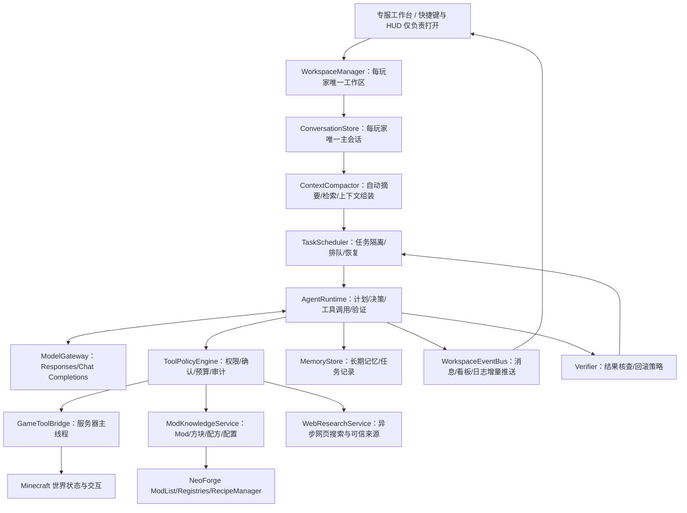

# FireflyMC AI 4.0：玩家专属 Minecraft Agent 重构技术方案

> 2026-10-28 玩家最新要求：工作台提供可直接切换、按本人工作区持久化的 **YOLO 模式**。开启后合成、加工、施工等操作无需玩家授权、确认或逐次批准；已有待批任务自动继续，固定蓝图位置由服务端自动采用。下文要求人工审批/世界预览确认的旧说明仅适用于关闭 YOLO 的手动模式。聊天打开时恢复历史，向上滚动自动加载更早对话；正文自动补齐并完整展示，不再以“更早历史”“查看全文”按钮作为读取前置；底部采用紧凑输入区。实现与验证见 [本次修复记录](ai4-yolo-workbench-chat-20261028.md)。

- 设计日期：2026-10-19；最近修订：2026-10-20；**全新实现、不做旧 AI 兼容/迁移、仅专用服务端、工作台唯一入口、玩家伙伴及默认私有规则已拍板**
- 代码基线：`Sakura520222/FireflyMC` 的 `3.1.0` 分支；当前工作区包含 P0 未提交实现，实际落点见 [P0 实施记录](FireflyMC-AI-4.0-P0-实施记录.md)
- Minecraft：1.21.1；NeoForge：21.1 系列；Java：21
- 状态：**P0 基础已有本地实现和自动化验证；本轮新边界尚待代码整改，P1—P3 尚未实现；改动未提交、未发布、未部署**。真实模型供应商、178 JAR 整合包和专服双客户端尚未验收；旧测试通过不代表已符合本轮新增约束。

## 1. 产品目标

将现有「聊天机器人 + 简单函数调用」重写为持久化、可审计、可验证的 Minecraft Agent。**每名玩家在每个服务器上拥有唯一、持续存在的 AI 工作区与唯一主会话**；所有对话和任务共享连续上下文、自动压缩；快捷键打开工作台，关闭后仍可后台执行，并通过可拖动 HUD 展示状态。玩家可以让伙伴查询游戏环境、发现 Mod 内容、联网检索攻略，并在相应授权后完成多步骤任务。自主建造要求真实盘点背包与授权仓库、求解配方和替代材料、阻塞/非阻塞主动提问、可视化蓝图区域审批与施工对账，严禁凭空生成资源。

**已拍板的实现与运行边界：直接实现全新 AI，不做旧版 AI 兼容、迁移或双引擎切换；AI 仅在专用服务端运行。** 单人世界、单人世界“对局域网开放”的集成服务器均不提供 AI，不初始化模型、任务运行时或 AI 私人工作区。连接符合条件的专服后，客户端仅承担工作台/HUD 展示；专服端复用 FireflyMC 现有身份认证。P0 已实现的新工作区、持久化与任务核心继续使用和完善，旧 AI 兼容分支、配置迁移及残留入口不属于保留目标。

**已拍板的产品边界：新 AI 只做玩家伙伴，玩家入口只有工作台。** 聊天、任务、审批、记忆管理和分享均在工作台内完成；统一通过 K 键打开同一工作台，HUD 仅显示状态，不提供按住左 ALT 释放鼠标或点击 HUD 的入口。取消 AI 交互命令、控制台 AI 聊天、普通游戏聊天唤醒和定时主动插话。新 AI 不提供改时间/天气、踢人、后台传送、刷物品等管理工具；这些操作继续由现有游戏/管理命令处理，玩家拥有 OP 也不会使其进入 AI 工具集。

**已拍板的玩法规则：全部 AI 加工免实体设备，并直接豁免附加加工成本。** AI 合成不需要玩家放置工作台，也不限于随身 2×2；烧炼、切石、锻造和 Mod 机器加工同样通过服务端虚拟加工完成。燃料、热值、FE、魔力/Psi、经验/等级消耗、加工等待及辅助工具耐久损耗均豁免，材料满足即可直接加工。真实配方原料、原料型流体、消耗型催化剂与容器仍照配方处理，输出、组件变换和副产物必须核验。这里的“AI 工作台”指聊天与任务 UI，不是物品合成所需的实体工作台。

**已拍板的现有模块命令规范：其他 FireflyMC 功能以 `/fireflymc` 为统一一级入口，明确保留 `/点歌 <歌名>` 快捷例外。** 点歌别名与 `/fireflymc music request ...` 共用业务和权限检查。新 AI 的工作台唯一入口约束优先于此前的 AI 命令子树方案，不再提供玩家/控制台 AI 交互命令，也不添加替代一级别名。

**已拍板的回答隐私规则：AI 回答默认仅本人可见；玩家逐条预览后才能主动分享。** 分享某条回答不授权广播整段会话、后续回答或工具日志；当前 P0 的配置式上行与保守提示策略需在 P1 按第 3.8 节调整，不代表分享 UI 已实现。

**已拍板的被动记忆规则：默认只记录工作台对话与任务；本人死亡、进度等事件通过工作台内独立开关启用。** 不被动采集全服/普通聊天，不因记录事件自动调用模型或公开插话；记录范围不扩展为其他玩家的私人历史。

**核心闭环：理解任务 → 制定计划 → 获取证据 → 使用工具 → 验证结果 → 修正 → 汇报。**

### 1.1 核心验收示例

玩家输入「帮我研究当前服务器的机械动力版本，给我一个适合本服的自动化制铁方案，材料不够则列清单，获得授权后帮我建造」。Agent 应：

1. 确认当前服务器是否存在对应 Mod，返回 Mod ID 和精确版本；
2. 查询机器与方块注册 ID、现有配方、相关机制资料；
3. 联网检索与 Mod 和 Minecraft 版本一致的官方资料、Wiki 或可追溯攻略，提供来源；
4. 分析实现路径、所需材料与运行条件，明确资料不足或无法确认的步骤；
5. 提交建造预览、预计变更方块数与风险，等待玩家授权；
6. 按可中断的批次执行，检查是否成功；
7. 失败时重试或执行可恢复操作，最终提供实际结果而非虚构成功。

不得默认授予玩家 OP 权限、不得修改未经授权的区域或向模型上传服务器密钥。

## 2. 核心架构



### 2.1 模块和职责

| 模块 | 建议位置 | 职责 |
|---|---|---|
| `WorkspaceManager` | `ai/workspace/` | 玩家唯一工作区、单主会话、任务引用、工作区状态恢复与同步 |
| `CompanionManager` | `ai/companion/` | UUID 身份、创建、删除、名称/风格设置、伙伴状态 |
| `AgentRuntime` | `ai/agent/` | 多轮推理、任务状态机、取消、工具调用、最后总结 |
| `TaskScheduler` | `ai/task/` | 玩家隔离队列、公平调度、并发数、时限、任务恢复 |
| `ModelGateway` | `ai/model/` | Chat Completions 和 Responses 协议适配、重试、上下文管理 |
| `ToolPolicyEngine` | `ai/security/` | 玩家授权、OP 权限、工具风险等级、审计及敏感数据过滤 |
| `ModKnowledgeService` | `ai/knowledge/` | 已加载 Mod、注册表、配方、数据包资源、配置摘要及版本化索引 |
| `ModIntegrationRegistry` | `ai/integration/` | 双端能力协商、可选适配器、版本与签名探测、失效与降级 |
| `RecipeKnowledgeService` | `ai/recipe/` | 服务端配方索引、JEI/EMI 展示线索、来源可信度和配方代次 |
| `VirtualProcessingExecutor` | `ai/processing/` | 免设备、免附加加工成本，按配方类型处理真实物料、输出与日志 |
| `WebResearchService` | `ai/web/` | 搜索 API、页面正文读取、可信域名评分、缓存、引用来源 |
| `GameToolBridge` | `ai/tools/` | 在 Minecraft 主线程执行必要的观察与世界操作 |
| `ConversationStore` | `ai/conversation/` | 唯一主会话、完整消息日志、版本/序列号、持久化回放 |
| `ContextCompactor` | `ai/context/` | token 预算、工具事务边界、自动压缩摘要与旧消息检索 |
| `MemoryStore` | `ai/memory/` | 玩家偏好、长期记忆、已完成任务、Mod 知识缓存 |
| `WorkspaceEventBus` | `ai/events/` | 事件序列与重放、消息流、工具进展和看板状态同步 |
| `CompanionWorkspaceScreen` | `client/ai/workspace/` | 快捷键工作台、富组件、看板、来源和审批、消息续传 |
| `CompanionStatusHud` | `client/ai/hud/` | 关闭工作台后的独立 HUD、锚点/拖动/缩放/透明度 |

只注册新契约 `AgentTool` 工具，不保留旧 AI 函数协议包装层或管理工具。需要的普通玩家业务通过新工具调用受信业务服务；UI 操作经身份绑定的协议交给运行时，不再经 AI 命令入口。现有音乐、认证、剧情与跨服传输等公共能力继续按自身职责提供服务。

## 3. 每个玩家的独立 AI 伙伴

### 3.1 玩家隔离

以 `serverInstanceId + playerUUID` 为主键；**每个键只有一个 `Workspace`、一个永久 `primaryConversationId`、一个默认 AI 伙伴**。任务是该主会话关联的可跟踪实体，不创建可见的独立聊天会话。各玩家的历史、长期记忆、预算、工具调用、任务和建造预览均隔离。不得继续采用旧版 `AIChatEventHandler` 的「每个 MinecraftServer 一个公用 ChatHistoryManager」模式。

建议按专服世界实例存储 `workspace/{uuid}/workspace.json`、`conversation/*.jsonl`（完整历史事件流）、`compactions/*.json`（模型可用的压缩摘要）、`tasks/*.json`、`artifacts/*` 与 `memory.json`。具体可位于 `<world>/data/fireflymc/ai/` 或数据库；世界型数据也可通过 Minecraft SavedData 保存，**不把巨量聊天全文写入每 Tick 的 SavedData 同步对象**。新系统自己的存储采用原子替换/事务、版本标识、完整性校验与恢复机制；不导入旧 AI 数据。保留全文供工作台浏览和恢复，压缩只改变模型上下文。工作区导出、记忆查看/忘记/清除与隐私删除均由工作台操作。

专服玩家必须通过既有 FireflyMC 身份认证后才能创建、读取或订阅本人工作区；离线模式昵称/未验证 UUID 不能作为可信身份。管理员和普通玩家遵守相同的本人工作区隔离。单机、集成服务器与 LAN 访客不进入 AI 认证/工作区流程，具体环境门禁见第 3.10 节。

### 3.2 角色与交互

默认伙伴名为 **“小萤”**，是玩家工作台中的逻辑 Agent；名称、称呼、人格和对话风格在新工作台中设置并持久化，不从旧 AI 名称/配置自动迁移。后续可增加实体化 NPC（跟随/停留/传送）与自定义皮肤；实体外观/行为与模型执行解耦，以免寻路和 AI 网络超时影响 tick。

| 工作台操作 | 行为 |
|---|---|
| 主会话输入 | 发起对话、研究和多步骤任务，始终写入本人唯一主会话 |
| 看板/任务卡 | 查看状态、暂停/继续/取消，展示明确的真实结果 |
| 审批/问题卡 | 预览后批准/拒绝，回答任务问题；与具体任务和方案版本绑定 |
| 记忆/设置 | 查看、忘记、清除与导出本人数据；修改伙伴资料和本人事件记录开关 |
| 单条回答分享 | 选择消息和目标，预览公开内容后确认 |

工作台是唯一人工 AI 交互入口；HUD/通知只展示状态并打开工作台，不另设输入框或快捷审批通道。不保留普通聊天唤醒、定时主动聊天或 AI 命令兜底；没有新客户端 UI 的连接不提供 AI 功能。其他模块仍使用 `/fireflymc` 规范及 `/点歌` 例外，不能被 AI 用来绕过自身能力边界。

### 3.3 唯一工作区、唯一主会话（新增硬性要求）

**用户心智模型：一个玩家 = 一个 AI 工作区 = 一个会持续成长的主会话。**

- 工作区标识 `workspaceId = (serverInstanceId, playerUuid)`，其中 `primaryConversationId` 在创建后保持稳定；玩家退出并重连、服务器重启、关闭/重开 UI，均不得新建或丢失该主会话。
- `Workspace` 内包含 `CompanionProfile`、`primaryConversationId`、`TaskBoard`、`Artifacts`、`KnowledgeRefs`、`Memory`、`ToolApprovals`、`UsageStats`、`HudPreferences`；**任务卡片不是新会话**，而是该主会话引用的执行记录。
- 玩家可以在主会话内直接说“继续刚才的工厂”“查看第三步”“照上一版修改”，Agent 应先检索任务 ID、上一次方案、坐标、Mod 版本和任务状态后再操作。
- 每位玩家使用独立的**逻辑串行会话写入器**（actor/mailbox 或单写事务队列）：不同任务允许并行读/检索，但模型请求/工具结果写入主会话必须按事件序列号提交，避免共享历史竞态。需提交世界修改的操作一律经过主线程队列与权限审核。
- 实现 `getWorkspace(playerUuid)`、`appendConversationEvent(workspaceId, event, expectedRevision)`、`getSnapshot(workspaceId, afterSeq)`、`resumeTasks(workspaceId)`；完整历史带 `seq`、`messageId`、`taskId?`、`timestamp`、`role`、`blocks`、`toolTransactionId?`。
- 不允许客户端自由指定其他玩家 UUID、工作区 ID、OP 上下文；以服务端验证过的连接身份绑定工作区。在离线模式服务器上，以现有账号验证流程保证玩家身份一致性。

#### 3.3.1 工作区与主会话数据参考

```text
Workspace
├── Identity: serverInstanceId + playerUUID
├── CompanionProfile: 名称、角色、个性、偏好
├── PrimaryConversation: 唯一主会话 ID
│   ├── Append-only Timeline: 完整聊天 / 工具事件 / UI 消息
│   ├── ActiveContext: 系统指令 + 摘要 + 最近轮次 + 任务状态
│   └── CompactionRevisions: 压缩版本及来源范围
├── TaskBoard: 待办 / 进行中 / 等待授权 / 完成 / 失败/取消
├── Artifacts: 建造蓝图、材料清单、配方报告、网页来源
├── Memory: 经核实的玩家偏好、长期事实和任务要点
└── Settings: 模型、预算、HUD、通知、数据保留
```

#### 3.3.2 会话生命周期

`CONNECT → DEDICATED_SERVER_CAPABILITY → AUTHENTICATE → LOAD_WORKSPACE → SYNC_SNAPSHOT → READY`；环境不支持或身份未验证时不加载私人工作区。断线不销毁专服工作区；重连先加载快照再补推 `seq` 之后增量。关闭界面只影响展示订阅，不取消任务或清空上下文；涉及本人背包/位置或世界写入的离线阶段默认暂停，已授权只读研究可在配额内继续。

### 3.4 游戏内 AI 工作台与按键绑定（新增硬性要求）

2026-10-26 实机反馈明确：统一按 K 打开；移除按住左 ALT 释放鼠标及 HUD 点击入口。每次打开主会话、发送新消息及点击“回到底部”后跟随最新内容，主动浏览更早历史时暂停跟随。顶部按钮按文字宽度紧凑排布并自动换行；没有可见正文的中间工具轮次不显示空白回答卡片，但完整历史和工具事务保留。

自然语言建造的默认路径为 AI 生成并定位固定蓝图候选，玩家在世界审阅幽灵预览并确认该版本的位置和范围，再审阅物料与施工审批。正常流程不以手填坐标或两角点为前置；手工选区保留为可选高级调整。聊天中的“继续”不能代替固定版本的位置确认或施工批准。

#### 3.4.1 按键入口与工作台

- 默认建议 `K` 打开 `CompanionWorkspaceScreen`；由 NeoForge 1.21.1 `RegisterKeyMappingsEvent` 注册，可通过 Minecraft 控制设置修改。只有当前连接的专服确认支持 AI 且玩家认证通过时才能打开私人工作台；单机/LAN、主菜单、无 AI 能力或禁用 AI 的服务器不提供可用入口。输入其他文本框时避免抢键。
- 点击/按键打开后，从服务端**恢复原工作区、唯一主会话和任务看板**，而不是重新 `new ChatHistoryManager()`。同一按键可根据界面状态关闭/返回，关闭不取消任务。
- 优先采用原生 Minecraft `Screen` + `GuiGraphics`，保持兼容 1.21.1/NeoForge。可采用可调整宽度的双栏工作台：左侧主对话，右侧任务看板；较小分辨率自动变成单栏和标签页。
- 可用标签建议：「对话」「看板」「资料/产物」「记忆」「设置」。主会话**始终只有一条**；标签页是同一工作区的数据视图，不是另开对话。
- 支持 Markdown/代码块/表格/消息检索、逐字流式渲染、工具调用折叠详情、来源、暂停/继续/取消按钮、任务引用跳转、复制内容、长会话虚拟列表与按需加载。
- 玩家网络短暂中断时展示同步状态，不清空正在输入的消息；服务端重连后补发尚未收到的消息事件，避免重复提交。

#### 3.4.2 富组件输出协议

AI 回复须允许丰富**可控的结构化组件**，不能只返回一个纯文本字符串。允许服务端经严格校验构建 `ResponseBlock[]`，客户端负责原生渲染：

| 组件 | 实际用途 |
|---|---|
| `MarkdownBlock`、`CodeBlock`、`QuoteBlock` | 说明、命令、代码与教程 |
| `TableBlock`、`StatCard`、`InfoCard` | Mod 比较、TPS 与材料统计 |
| `TaskCard`、`ProgressBlock`、`StepTimeline`、`Checklist` | 看板、计划步骤、执行进度 |
| `ItemStackBlock`、`RecipeBlock`、`BlockPreview` | MC 物品图标、合成配方、建造预览 |
| `SourceLink`、`EvidenceBlock` | 攻略来源、Mod 版本、验证依据 |
| `ApprovalPrompt`、`ConfirmAction` | **服务器生成**的授权按钮、明确影响范围与撤销信息 |
| `ErrorBlock`、`RetryStatus` | API/游戏操作失败状态及恢复动作 |
| `QuestionCard`、`DecisionCard` | 阻塞/非阻塞主动提问、答案与待处理状态 |
| `MaterialLedgerCard`、`BuildRegionCard`、`BlueprintDiff` | 可用/已预留/缺少材料、施工选区与蓝图差异 |
| `ModIntegrationCard`、`ProcessingCostCard` | 展示适配状态、真实物料消耗、输出及“免设备/免燃料/免能耗/无加工等待”规则 |

协议建议 `AiUiEnvelope(version, workspaceId, messageId, seq, taskId?, blocks, actions)`。**模型不具备发送任意 HTML、JS、任意 URL 交互脚本、服务器命令的权力**：输出只能匹配服务器白名单 Schema；高风险交互控件由受信任的 `ToolPolicyEngine` / 工作流生成并关联一次性操作授权令牌，客户端不能直接决定执行权限。未知组件降级为安全纯文本。

#### 3.4.3 任务看板与消息关联

看板列：`TODO / IN_PROGRESS / WAITING_APPROVAL / WAITING_ANSWER / WAITING_RESOURCES / COMPLETED / FAILED_OR_CANCELLED`。每张卡片关联 `taskId`、主会话消息锚点、目标、真实进度、任务步骤、权限状态、产物、时间戳、可取消性和重试信息。

- 玩家可查看任务的“计划 → 调研 → 执行 → 校验 → 已完成”每一步，并直接从卡片跳转到主会话的相关回答。
- 任一任务支持暂停/恢复/取消；UI 仅发出请求，实际状态由服务端判定后同步；取消不会清空会话或其他任务。
- 两个任务同时需要主会话的上下文时，允许只读工具并发，但模型侧的上下文提交采用单写队列；每项可变更世界的操作需序列化且带幂等键。
- 看板可在关闭界面时继续变化；重新打开必须显示最新完成或失败状态。

#### 3.4.4 关闭后 HUD

- 关闭工作台后，默认在**左下角**渲染 `CompanionStatusHud`，显示伙伴名、当前任务、执行状态、进度、待批准数/失败提示与简短活动摘要；默认不遮挡热键栏与聊天框。
- 允许设置布局锚点（左下、右下、左上、右上）、通过设置界面拖动位置、`normalizedX/Y`、缩放、透明度、折叠/自动隐藏、不同状态的提示频率；偏好由客户端按服务器身份+玩家持久保存。
- HUD 不是独立会话，只是工作区的状态投影；统一按 K 打开同一工作台，不捕获左 ALT 或通过悬浮鼠标点击 HUD 打开。任务完成或需要授权时可弹出非侵入提示，严禁全屏抢焦点。
- 1.21.1 可通过 GUI layer 机制注册 HUD，使用 `GuiGraphics` 绘制；具体事件签名须在 `21.1.x` 目标版本编译验证。

### 3.5 自动上下文压缩与可恢复记忆（新增硬性要求）

**要求：永不因上下文长度而随机遗忘正在执行的任务；完整聊天可回看，模型输入可压缩。**

#### 3.5.1 区分三类数据

1. **完整时间线（不可因压缩而丢弃）**：持久化玩家真实对话、工具事务、任务事件与产物引用；供用户浏览、检索、审计，并按明确的数据保留策略清理。
2. **工作上下文（发送给模型）**：系统/权限边界、结构化任务状态、经验证的长期记忆、较旧历史的滚动摘要、近期原文消息与必要工具结果。
3. **长期记忆与知识索引（可检索）**：玩家经常使用的工作方式、已有建筑坐标、Mod 版本/攻略来源、已完成任务摘要；长期记忆须注明来源、更新时间与可置信程度，可查看与清除。

#### 3.5.2 Token 预算与压缩触发

- 识别模型/提供者标称上下文窗口 `W`；预留输出 `O`、工具结果增长 `T` 和安全余量 `S`，得到实际输入预算 `B = W - O - T - S`。未知模型不能假设支持巨大上下文，需保守默认并允许管理员配置。
- 在每次新模型请求前估计 `inputTokens`（优先采用对应模型 tokenizer/提供者 usage，无法精确时使用带安全系数的估算）；当 `inputTokens` 达到约 `0.70 ~ 0.80 × B` 时触发压缩；若一次工具结果异常巨大，先截断/结构化摘要工具内容并把详细原文存入产物，避免直接挤爆上下文。
- 触发由**Token 使用量而非消息条数**决定，不能再用旧版 `maxHistorySize=30` 的做法简单弹出最早消息；`contextWindow`、`reserveOutputTokens`、`compactionThreshold`、`keepRecentTurns` 可按模型设置。
- 压缩异步执行，使用指定廉价/快速模型或当前模型，生成摘要时保留 `sourceMessageRange` / `summaryRevision` / `timestamp` / `model` / `digest`；压缩失败时不能丢原始聊天，改为较短上下文+显式状态/检索恢复。

#### 3.5.3 压缩策略（保真优先）

- 固定保留系统约束、开发者策略、权限、当前玩家输入、最近若干完整对话轮次、活跃任务状态、待授权操作，以及**未完成/成组的 tool_calls → tool_results**；压缩边界必须按完整轮次与工具事务切割。
- 旧历史压成结构化 `ConversationSummary`：`goals`、`confirmedFacts`、`preferences`、`decisions`、`taskRefs`、`worldCoordinates`、`modVersions`、`sourceRefs`、`pendingQuestions`、`failures`、`safetyConstraints`；不确定的事实标记来源/置信度，不把错误推测写成事实。
- 不把大型 Mod 注册表、所有配方、整份网页全文塞入摘要：只保留**索引引用**，需要时按 `modId`、物品 ID、任务 ID 从知识缓存按需检索并注入。
- 模型要使用更早的信息时执行 `conversation.search` / `artifact.read` / `memory.lookup`，而不是凭摘要猜测。
- 玩家可查看“上下文占用”“上次压缩时间”“目前摘要”与“恢复被压缩内容”，支持手动触发压缩，但手动压缩同样不能丢失完整历史。
- 不得将 API 密钥、管理员配置原值、其他玩家私聊或未经授权的服务器数据写入摘要和长期记忆。

#### 3.5.4 上下文安全与任务一致性

每个上下文状态对应递增 `conversationRevision`；压缩过程基于快照 `revision=N`，提交前如果有新事件，必须重新基于最新变更合并/重算，避免摘要覆盖新消息。正在执行的任务持有状态引用但不能静默篡改主会话历史；压缩之后仍应可准确回答“我现在进行到哪一步、接下来要做什么、有哪些已授权操作”。

#### 3.5.5 示例工作流

```text
玩家：查一下机械动力怎么做自动化农场。
AI：查 Mod / 配方 / Wiki → 给出攻略、材料清单（消息 #130）。
玩家：那就在我现在的位置建一个。
AI：读取消息 #130 的方案 → 生成预览 → 等待授权（任务 #47）。
[关闭 AI 面板，继续正常玩 Minecraft]
AI：授权通过后按 Tick 建造 → 验证 → 保存完成结果。
[会话接近 Token 预算 → 自动压缩旧对话，保留任务 #47 及方案引用]
玩家：帮我把刚才农场的材料换成更便宜的。
AI：通过任务 #47 和原始产物检索完整材料 → 重新计算，而不是忘记前文。
```

### 3.6 后台执行、掉线和服务器重启策略

- **关闭 UI：不中断** 网络模型回复、联网搜索、任务计划、工具调用和主线程分批世界操作；客户端仅取消当前 UI 渲染订阅，服务端负责持久运行。
- **玩家正常在线但面板关闭：继续执行**，HUD 保留状态摘要，涉及授权时任务转入 `WAITING_APPROVAL`，不得默许危险操作。
- **玩家离线：**只读研究任务可按配额继续；需玩家位置、背包、领地验证或实际世界写入的任务默认暂停。可见回连时再次验证权限、世界版本和素材库存后继续。
- **服务器关闭/重启：**保存 `WorkspaceSnapshot + TaskCheckpoint + ToolExecutionJournal`；重启恢复后核验幂等/世界状态，不能重放已执行的掉落、发物品、扣材料等非幂等操作；有不确定性的操作转待核验状态。
- **任务错误：**UI 和 HUD 给出可理解的失败原因、可重试/已暂停状态；不允许不通知玩家地无限重试或假报成功。
- **成本与公平性：**服务端可限制每玩家同时运行的模型任务数、搜索配额、token 使用量；后台任务不能无界占用线程或拉低 TPS。模型/网络在异步线程，Minecraft 对象的读取/修改在主线程小预算内完成。

### 3.7 客户端-服务端工作区同步协议

采用 NeoForge 1.21.1 `CustomPacketPayload` / `StreamCodec` / `RegisterPayloadHandlersEvent` 机制，专用服务端是工作区权威来源，客户端只保存安全展示偏好和未发送草稿。能力协商先区分 `NOT_SUPPORTED`、`DISABLED`、`AUTH_REQUIRED`、`READY`；环境/认证门禁在运行时创建及每个工作区请求入口执行，不能只靠客户端隐藏按钮。

| 消息 | 方向 | 用途 |
|---|---|---|
| `WorkspaceOpenRequest` | C → S | 鉴权后获取本人工作区快照/版本 |
| `WorkspaceSnapshot` | S → C | 主会话最新页、看板、伙伴状态、压缩指标 |
| `ConversationSubmit` | C → S | 带 `requestId` 的新指令，服务器去重，防止多发 |
| `WorkspaceEventBatch` | S → C | 按 `seq` 推流新增消息、工具状态、组件数据 |
| `WorkspaceEventsSince` | C → S | 断线后按 `lastAckSeq` 请求补同步 |
| `TaskControlRequest` | C → S | 请求暂停、继续或取消特定任务 |
| `ApprovalResponse` | C → S | 对服务器生成的授权动作回复，重新鉴权 |
| `WorkspacePreferences` | C ↔ S（可选） | 同步非敏感展示偏好；默认本地保存 HUD 布局 |
| `QuestionEvent` / `QuestionAnswerRequest` | S → C / C → S | 统一主会话中的阻塞与非阻塞提问、归属校验及恢复 |
| `BlueprintPreviewManifest` / `BuildApprovalResponse` | S → C / C → S | 世界蓝图预览分片与固定版本计划审批 |
| `ClientIntegrationHello` / `IntegrationCapabilities` | C → S / S → C | 最小化客户端模组能力自报、服务端已核实能力及协议版本 |
| `RecipeDisplayRequest` / `RecipeCandidateReport` | S → C / C → S | 打开 JEI/EMI 视图、接收展示配方线索；不授予执行权 |
| `BlueprintImportProposal` / `BlueprintTransformProposal` | C → S | 导入选中 Forgematica 摆放或提出变换，服务端重新编译、审查和定版 |
| `SharePreviewRequest` / `SharePreview` | C → S / S → C | 仅本人选定消息与目标频道的公开内容预览，返回服务器生成的预览 ID 与内容摘要 |
| `SharePublishRequest` / `ShareResult` | C → S / S → C | 确认固定预览，重新鉴权、去重并发布；不接受客户端任意替换正文或目标 |

要求协议版本与能力协商、压缩/分页、每包最大尺寸、服务端输入长度限制、速率限制、消息序列号与去重；长结果分块或以产物 ID 读取。客户端不能提交任意结构化“工具结果”冒充服务端事件，不能随意指定其他玩家工作区。

### 3.8 默认私有与逐条预览后分享（2026-10-20 已拍板）

1. 小萤回答、任务详情、工具结果、审批、记忆和压缩摘要默认仅工作区本人可见，不自动发到全服、跨服或 QQ 通道；完成提示也不自动对外广播。所有 AI 输入来自工作台；普通公开聊天仍按原规则传播，不进入 AI 对话、不触发 AI 唤醒/主动回复。
2. 每条可分享回答提供“分享”操作：本人选择消息和目标（本服聊天/实际可用的跨服频道）→ 服务端生成经过字段白名单和敏感信息过滤的**最终公开正文预览** → 本人确认 → 服务端发布。预览必须显示正文、署名、目标/受众与截断情况，不隐藏额外附带内容。
3. `SharePreview` 绑定 `ownerUUID`、`workspaceId`、`messageId`、`messageRevision`、`contentDigest`、目标频道、有效期与一次性请求 ID。确认前重新检查身份、消息归属、内容版本和目标权限；过期、编辑、撤回、失权或目标改变后重做预览。重试只返回原结果，不能重复广播。
4. 单次分享只发布已确认的消息片段；历史、相邻回复、引用的完整文件/产物和后续完成通知不随之公开。审批令牌、内部工具参数、服务器密钥、他人私密信息及可执行 UI 控件永不进入公开正文；本人分享不扩大其原有数据访问权。
5. 在本人时间线记录分享正文摘要、目标、时间与实际结果；发布失败明确说明，不把“已点击确认”当成功，也不承诺跨服平台支持撤回。普通游戏聊天/点歌播报的现有公开规则与 AI 私有工作区分开执行。
6. **实施边界**：P0 当前的配置式自动上行与普通聊天触发属于待清理行为；新实现直接采用默认私有路由及显式分享，不保留旧 AI 广播兼容开关。现有跨服传输只承载已经本人确认、服务端核验的公开分享，不监听整个私人会话。分享 UI 和路由仍待实施。

### 3.9 本人事件记忆（默认关闭、工作台按项开启）

- 默认只持久记录工作台对话、任务及其工具/审批/结果；本人死亡、进度等被动事件各有独立工作台开关，初始关闭。事件来源限定当前已认证玩家，不采集全服/普通聊天或他人私人事件。
- 事件记录带 `ownerUUID`、来源类型、时间、维度/必要位置和原始事件引用，写入本人的事件索引；模型按任务需要有界检索，不把所有原文无差别塞进上下文。
- 打开开关不回填过去的全服历史；关闭即停止该类新记录，不擅自删除已保存会话。本人可在工作台查看/清除相应记录，沿用明确的数据保留策略。
- 记录事件本身不调用模型、不自动发起新任务、不公开插话。已获授权的后台任务仍可在工作台关闭时继续，任务内主动问题进入本人工作台/HUD 待处理，不变成公共聊天入口。

### 3.10 专用服务端运行门禁（单人/LAN 不提供）

- 本节 LAN 指单人世界对局域网开放的集成服务器；部署在局域网中的**专用服务端仍可提供 AI**。门禁按服务端类型、服务开关和认证状态判断，不按公网/私网 IP 判断。
- 只有专用服务端可以初始化 AI 配置、模型网关、任务调度、私人工作区和 AI 工具注册。单人及对 LAN 开放的集成服务器不启动这些服务、不加载 AI 密钥、不发模型请求、不新建 AI 数据目录；不存在客户端本地推理或独立 AI 降级路径。
- 客户端在进入/离开服务器时清理能力与展示订阅；只有目标专服启用 AI 且本人通过现有 FireflyMC 身份认证时下发私人数据。未验证时仅提供认证状态/现有登录引导，口令不进入 AI 对话或 LLM。
- 即使客户端修改开关、伪造工作区请求或玩家为 OP，也不能在集成服务器启用 AI 或访问其他玩家工作区。专服禁用 AI、客户端未安装界面或目标服无对应能力时，明确显示不可用且不建立备用 AI 入口。
- LAN 访客 AI 认证适配不在本轮目标内，先前“LAN 验证后可用”的讨论由本条最新规则取代。现有 LAN 联机/认证的非 AI 业务继续保留。
- 验收覆盖真实专服的已验证双客户端，以及单人、LAN 房主/访客、不支持/禁用 AI 的服务器、伪造请求和重连。GameTest 的逻辑验证不能代替这些环境门禁实测。

## 4. Mod 知识与探测能力

### 4.1 已加载 Mod 目录

使用 NeoForge `ModList.get().getMods()` 读取服务端已加载 Mod 的 ID、显示名称、版本、描述及可用元数据。内置分页、模糊搜索、筛选；从依赖和版本信息构建兼容性上下文。

**边界：服务端仅能可靠枚举实际在服务端加载的 Mod。** 纯客户端 Mod 不会自动出现在服务端列表；需要专用客户端上报协议并取得玩家同意，且把其结果标记为「客户端自报」。

### 4.2 游戏注册表与世界数据

通过 Minecraft/NeoForge 1.21.1 注册表查询：

- 方块、物品、实体、状态效果、附魔、流体等的注册 ID 和命名空间；
- 方块默认状态、可用属性、是否具有对应物品、物品描述/标签等可核实属性；
- 配方、配方类型、物品标签、进度/成就、数据包定义与动态注册表中可查询的内容；
- 当前世界、维度、玩家周围机器/方块状态与其附属 BlockEntity 的**受限公开状态**。

将索引划分为 `modId → 注册条目 → 配方/资源 → 来源`。缓存键必须包含 Minecraft 版本、NeoForge 版本、Mod 集合及数据包版本/重载版本，防止旧攻略混入。

**重要限制：通用注册表不能解释所有 Mod 的专属机制**，如机器内部逻辑、多方块结构、扩展能量网络、任务系统。应结合 Mod 内数据资源、作者文档、Wiki，必要时编写专属 Mod 适配器；不得因为方块存在就声称理解完整玩法。不能在生产服务器中执行陌生 Mod Jar 的反编译/任意字节码逻辑。

### 4.3 配置与服务器信息

支持扫描配置条目的名称、类型、可公开注释、有效值及默认值差异（经白名单、脱敏处理）。涉及 `STARTUP`、`COMMON`、`SERVER`、`CLIENT` 四种配置范围：专用服务器不得声称能直接获取每个玩家客户端配置。

优先通过注册的 NeoForge 配置接口访问；文件回退严格限制在受允许的 `config/` 与当前世界 `serverconfig/` 目录中，拒绝路径穿越、符号链接逃逸和任意文件读取。

服务器工具可读取：在线人数、TPS/MSPT、运行时长、服务器版本、游戏规则、难度、维度、世界时间、已加载数据包、玩家自己的位置/装备与其他获许可的状态。

普通玩家不能读取私密管理配置，例如 API Key、RCON 密码、玩家验证凭据、Webhook Token、数据库口令、代理认证信息、环境变量和内部路径；管理员也只能获得经过最小化脱敏后适合发送给模型的信息。**敏感原值永不进入 LLM 请求、日志或 Web 查询。**

### 4.4 本整合包联动基线（2026-10-20 静态盘点）

本轮读取 `D:\Game\MC\.minecraft\versions\FireflyMC\mods` 的 **178 个顶层 JAR**，解析包内模组元数据、嵌套依赖和重点类签名；完整分类与逐 JAR 清单见 [模组联动清单](FireflyMC-AI-4.0-模组联动清单.md)。包内另有 174 个嵌套 `.jar` 条目，不等于另有 174 个独立已加载 Mod。**磁盘文件、元数据声明、客户端运行加载和专用服务端运行加载是四种不同证据**；本轮没有启动游戏或服务器，不把盘点结果冒充运行结果。

当前优先联动链路为：**Forgematica + MaFgLib 蓝图 → 服务端材料与配方计划 → JEI/EMI 查询展示 + Polymorph 冲突选择 → 虚拟加工 → 授权储物设备取料 → Open Parties and Claims 权限检查 → FireflyMC 分批施工与验证**。

- 已存在：Forgematica `0.4.2+mc1.21.1`、MaFgLib `0.4.3+mc1.21.1`、JEI `19.39.0.369`、EMI `1.1.24+1.21.1+neoforge`、Polymorph、Storage Drawers、Sophisticated Storage/Backpacks/Core、Curios、女仆及附属、Jade、Xaero 地图、Waystones、FTB Ranks/Ultimine、Open Parties and Claims、Farmer's Delight、Chipped、Quark、Supplementaries 等。
- 此目录没有 Create、AE2、Refined Storage、Mekanism 顶层 JAR；文中相关例子只保留为未来适配器扩展，不能成为本整合包 P2 的必要条件，也不能声称已发现其机器或网络。
- `blueprint-1.21.1-8.1.1.jar` 是 Team Abnormals 的基础库，不能按名字当成全息蓝图；Forgematica 内还声明兼容 ID `litematica`，MaFgLib 内还声明 `malilib`，探测时须区分真实目标与 Stub。
- Aether 还内嵌 Accessories `1.1.0-beta.48+1.21.1`；它有独立饰品能力接口，不能假设 Curios 覆盖全部装备槽。需核对运行时选中的嵌套版本及桥接关系，再做装备/携带库存去重，不改变 178 个顶层 JAR 的统计。
- 方块、物品、标签、普通配方和世界生成内容优先走通用索引；仅在需要专属状态、输入成本、权限或操作语义时增加适配器。渲染优化、音效、工具提示和基础库无需逐个变成 LLM 工具。

### 4.5 可选适配器契约与双端边界

每个 `ModIntegrationDescriptor` 至少记录 `adapterId`、`requiredModIds`、`testedVersions`、`logicalSide`、`protocolVersion`、`requiredSignatures`、`providedCapabilities`、`limitations`、`probeEvidence`。状态区分 `DISCOVERED`、`STATIC_API_MATCH`、`RUNTIME_READY`、`UNSUPPORTED_VERSION`、`FAILED`；**找到类或方法只说明静态接口存在，不等于已通过集成验收**。

1. 公共代码与专用服务端不得静态引用 Forgematica/MaFgLib、JEI/EMI、地图或其他客户端类；客户端入口经 Mod 存在性、版本和接口探测后延迟加载。开发时通过可选依赖编译，不能把整套第三方 JAR 打进 FireflyMC，也不修改玩家的安装文件。
2. `ClientIntegrationHello` 仅报告用户启用的适配能力、必要 Mod ID/版本与协议；不上传完整目录、配置和地图文件。客户端报告标为 `CLIENT_REPORTED`，只能用于 UI 选择或研究线索，不能证明服务端存在某物品、配方、库存或权限。
3. 能力按只读、展示、取料、加工、世界修改分开注册。同一个 Mod 能被识别，不代表它的全部动作均已授权。版本/签名失配时只停用受影响能力并给出原因。
4. Forgematica/JEI/EMI 等展示失效时回退内置 UI；取料或加工适配器失效时暂停依赖步骤、对账并重新计划；**领地保护适配器失效时拒绝受影响的写入和取料，不能按“无保护”降级**。
5. 缓存和执行计划绑定服务端 Mod 集合、`recipeGeneration`、数据包代次、适配器版本和 `costPolicyHash`。更新、重载或连接到另一服务器后重新协商；旧客户端建议与旧批准不得跨代次执行。

## 5. 联网调查与攻略系统

采用可替换的搜索 Provider：自建 SearXNG、Brave Search、Tavily 等；外部网页读取通过受限 HTTP 客户端，默认按「官方 Wiki/Mod 官网 → GitHub README/发布记录 → Modrinth/CurseForge 页面 → 社区攻略」排序。

每份来源记录：标题、URL、检索时间、Mod 名称、Mod 版本、适用 Minecraft 版本和引用片段。对于没有版本证据的攻略要明确提示可能过时。

Web 安全：禁止请求本机、内网、云元数据地址和非 HTTP(S) 协议；检查 DNS 解析结果及每一次重定向；限定大小、超时、字符数，清理 HTML 和提示词注入内容；网页内容永远是「资料」，不能成为对 Agent 的权限指令。可配置 HTTP(S) 代理与缓存，但不可向第三方泄露内部配置。

## 6. Codex 式任务执行引擎

### 6.1 状态机

`QUEUED → PLANNING → RESEARCHING → EXECUTING → VERIFYING → COMPLETED`

其中可转向 `WAITING_APPROVAL`、`RETRYING`、`FAILED`、`CANCELLED`、`PAUSED`。每一步都有 `taskId / playerUUID / toolName / inputDigest / output / duration / permissions / changes`。

每次模型决定使用工具后，必须把**全部实际接受的 tool_calls** 及其完整结果成组加入模型上下文；下一轮按返回结果继续。到达调用或时间预算时，停止提供工具，强制请求一次总结或明确告知未完成；绝不直接静默退出。

### 6.2 模型协议

`ModelGateway` 统一抽象模型事件 `TextDelta`、`ToolCalls`、`ToolResultAck`、`Error`、`Completed`：

- Chat Completions：遵循 assistant `tool_calls` + tool `tool_call_id` 结构；
- Responses：遵循 `function_call` + `function_call_output` 结构，按模型/网关要求维持相关响应状态；
- 对不支持工具调用的模型标识只读聊天降级，不能伪造执行成功；
- 显式配置是否允许并行工具建议，但服务器端改变世界的工具**始终串行**提交；
- 非网络异常与超时采取有界重试和退避，禁止重放已经执行的有副作用工具；
- 所有模型输入均经过 `ContextAssembler + ContextCompactor`；基于 token 预算自动压缩旧轮次，保持未完成工具事务完整，原始聊天与任务状态仍持久化；
- 支持任务级最大步骤、最大工具数、最大时长、成本/Token 预算和人工取消。

### 6.3 工具契约

所有新工具声明 `name`、`description`、`inputSchema`、`riskLevel`、`requiredCapability`、`executionThread`、`maxExecutionBudget`。

工具返回结构化结果：`success`、`errorCode`、`summary`、`observations`、`evidence`、`worldChanges`、`retriable`。模型提供的参数视为不可信输入，业务工具执行前再校验一次。

| 只读工具（普通玩家可按策略访问） | 有副作用工具（需要授权） |
|---|---|
| `mod.list`, `mod.describe`, `registry.search`, `recipe.lookup` | `world.build_blueprint`, `world.undo_safe` |
| `mod.config.summary`, `server.public_status`, `player.inspect_self` | `inventory.reserve`, `processing.execute` |
| `world.scan_nearby`, `world.inspect_block` | `world.place_planned_block`, `companion.assign_task` |
| `web.search`, `web.open`, `knowledge.lookup` | `share.publish_confirmed`（仅发布本人确认的固定预览） |

新 AI 工具集不含改时间/天气、踢人、管理他人、后台传送、刷物品/生物、全服清理、修改服务器配置或执行任意命令。OP 玩家也不注册这些工具。合法采集、使用指路石、按真实配方产生实体等属于受限玩家行为，需要对应机制与授权，不能通过管理命令或裸写入替代。

支持工具插件扩展点，让未来的机械动力、AE2、Mekanism 等 Mod 适配器注册机器状态查询、网络检测、交互与验证工具，而不是硬编码到提示词。

### 6.4 AI 自主建造：真实资源驱动的可审查执行系统（2026-10-20 新增硬性要求）

> **目标：AI 能持续调查地形、真实盘点玩家物品、规划替代材料和合成路径、向玩家提问、生成蓝图并在获批后自主施工及验证。** 任何材料均不得凭空生成；LLM 只负责计划和策略，**物品账本、配方是否合法、库存扣除、世界修改和权限**由可信服务端代码作最终判定。

#### 6.4.1 必须保留的系统不变量

1. **守恒**：生存建造每次产出都必须对应真实原料消耗、合法配方产出或真实世界采集；禁止利用 `give_item`、创造模式物品生成、裸 `setBlock` 或管理员权限绕过材料扣除。OP 权限不是无穷资源。
2. **可验证**：不可把“模型声称已合成/已建造/已取得材料”视为成功。服务端必须检查 ItemStack/BlockState 与实际进度。
3. **先审后做**：区域占用、初始拆除、重要方块替换、材料消耗范围、机器连接与不可逆操作，均须可预览且在授权范围内执行。
4. **权限不扩张**：玩家只能动用自己的物品栏、明确授权的容器和允许建造的区域；物品库存与世界方块不能因为 Agent 拥有服务器执行线程而绕过保护 Mod。
5. **任务可持续**：关闭工作台后，已获批准且安全的阶段继续；玩家离线后涉及其背包、真实世界写入的阶段默认暂停；服务器重启后可核对进度并恢复，不得重复消耗/发放物品。
6. **物品不可无损回滚承诺**：失败后优先补偿与恢复可安全恢复的世界状态；已经参与不可逆机器加工、流体消耗或掉落变化的材料，不得假称可全部回滚。

#### 6.4.2 建造任务生命周期

`REQUESTED → SURVEYING → BLUEPRINT_DRAFT → MATERIAL_AUDIT → RECIPE_PLANNING → SUBSTITUTION_REVIEW → PREVIEW_READY → WAITING_APPROVAL → RESERVING → BUILDING → VERIFYING → COMPLETED`

可分支到：`WAITING_ANSWER_BLOCKING`、`WAITING_RESOURCES`、`WAITING_WORLD_PERMISSION`、`REPLANNING`、`PARTIALLY_BUILT`、`PAUSED`、`CANCELLED`、`RECOVERY_REQUIRED`、`FAILED`。任务变更必须生成新 planRevision；旧批准不可用于不同蓝图。

执行顺序：

1. 解析自然语言目标：建筑功能、风格、规模、目标玩家、需要的 Mod 机制、是否允许拆除、是否仅在已有物资条件下建造。
2. 扫描候选位置：当前维度、玩家朝向和位置、地形高度、积水/岩浆、被占方块、现有建筑和容器、世界边界、区块状态、保护策略；AI 可建议多个位置，但不能私自批准选区。
3. 生成**不可变蓝图草案** `BlueprintPlan`；保留每个目标位置的精确 `BlockState`、朝向、阶段、依赖与可替换材料类别；含不自动复制的敏感/特殊 BlockEntity 数据（需要显式白名单适配）。
4. 对比差异：已经存在且符合蓝图的方块不再消耗材料；需要移动、清除、替换的方块逐个列入影响清单并评估风险。
5. 盘点真实库存、允许来源和已有资源；求解可替换项与合法合成路径，形成材料预算。库存或配方改变时必须重算。
6. 将施工影响范围框选并呈现半透明方块投影、物料与拆除预览；等待玩家批准**带哈希的确定版方案**。
7. 通过权限门禁、材料检查与事务预留后分批施工；发生异常时进入局部重规划或提问，而不是强行放置、创造材料或跳过保护。
8. 每批按世界和物品账本核实；完成后检查结构、方块状态、关键组件连接、必要的机器供能/流体/配方运行条件；失败则标记待修，不谎报完成。

#### 6.4.3 玩家物品栏与授权仓库：`MaterialInventoryService`

- 以服务端 `Player#getInventory()` 为事实来源，逐槽盘点主背包/快捷栏/副手（是否能消耗装备栏物品必须单独授权），区分 Item ID、数据组件、耐久、容量、容器物品、NBT/自定义名称和不可堆叠物品。不得仅按显示名或物品标签聚合所有库存。
- 支持可选的来源：玩家明确选定的箱子、潜影盒、本整合包的 Storage Drawers、Sophisticated Storage/Backpacks，以及经单独授权的 Curios/Accessories 携带背包或女仆物品栏。标准容器通过 NeoForge `Capabilities.ItemHandler.BLOCK` / `IItemHandler` 适配，物品型存储走对应 Item capability；网络和特殊存储通过独立适配器。Create/AE2/RS 仅为未来扩展。**未授权箱子绝不自动搜索/提取**。
- 物品来源与权限要绑定：`ownerUUID`、`dimension`、`containerPos`、`side`、`sourceRevision`、`reservationId`；容器被破坏、物品被其他玩家取走、权限失效时停止当前取物步骤并重算。
- `MaterialLedger` 返回四种库存：`available`（真实可用）、`reserved`（已有任务预约）、`committed`（真实已消耗）、`missing`（经审查仍缺少）。**仅记账预约不等于已物理取走**，不得让两个并发任务重复消耗同一物品。
- 施工时应设计可核验的物品提交协议：在主线程重校验库存和授权 → 记录有唯一 `operationId` 的准备记录 → 实际扣除/预留物品 → 记录对应方块/合成产出 → 提交 journal；崩溃恢复根据真实世界和背包状态核对，不盲目重放。跨容器和跨 Tick 不是真正的数据库原子事务；应采用幂等步骤、保守恢复和明确的补偿记录。
- 只允许用真实已存在或合法加工取得的物品施工；新 AI 不提供创造/管理员无限资源模式，OP 不免除材料和方案审批要求。已拍板的加工附加费用豁免不等于免费产生配方原料。
- 同一库存可能经抽屉控制器/单抽屉、双箱两侧、背包物品/已放置背包等多入口访问，必须按后端身份去重、共享预留；不能重复计入。遵守抽屉锁定、数量上限、封存和精妙存储槽位/升级语义；不把虚拟槽、创造/无限供给、虚空销毁当成普通生存库存。回填前确认来源仍存在且允许插入；失败则保留在受审计的任务托管区，不能把返还物送入虚空升级或直接丢地上。
- 装在玩家槽位/饰品槽中的背包要绑定宿主物品身份、组件摘要与槽位版本，禁止直接改其私有 NBT；背包移动、卸下、升级或来源权限变化后重新定位。嵌套容器设深度/遍历上限、环检测与去重；盘点装备不等于允许消耗装备。

#### 6.4.4 智能替代：`MaterialSubstitutionPlanner`

- 先把蓝图材料按用途分类：`FUNCTIONAL_EXACT`（机器、红石、可交互组件、特定 BlockState）/ `STRUCTURAL`（承重、透明度、强度或碰撞需求）/ `DECORATIVE`（颜色、纹理、视觉偏好）/ `HAZARD_SENSITIVE`（火、水、传导、易燃或可能改变玩法）。
- **装饰材料**：可以在玩家偏好和批准的材质范围内，用实际持有的方块替代；例如缺少云杉木板时考虑橡木木板，但颜色/风格发生可见变化，应反映到蓝图并在批准前明确提示。
- **结构材料**：按碰撞、承重逻辑、透明/透光、可燃性、水浸与方块状态约束筛选，再由环境验证；不能简单把玻璃、楼梯、实体方块当作任意等价物。
- **功能材料**：禁止因名称相似、标签相同就替换；机器、轴、传送带、熔炉、红石中继器等必须保持行为语义，只有已验证的适配器证明可替代时才允许。
- 对候选替代项使用可解释的评分：`可用数量`、`功能兼容`、`风格接近`、`合成成本`、`需要修改的蓝图量`、`玩家明确偏好`；分数只能用于排序，**不得绕过硬性兼容约束**。
- 当替换改变外观/机理或使用玩家标记为保留的珍贵材料时，提出**阻塞提问**；允许的低风险等价替换可按事先授权继续，同时在看板提示。
- 提供可审阅差异：`原方块 -> 替换方块`、数量、受影响位置、库存依据、预计功能影响。每次替换产生新的 `blueprintRevision` 和材料预算哈希。

#### 6.4.5 全加工免设备：`CraftingPlanner` + `VirtualProcessingExecutor`

**设备要求统一取消，配方与物料校验统一保留。** 所有加工路径都由可信服务端 `ProcessingAdapter` 在虚拟上下文中执行；实际缺少工作台、熔炉、切石机、锻造台、Chipped 工作台或其他 Mod 机器，不构成等待理由。复杂配方尚未适配时应明确报告 `UNSUPPORTED_PROCESSING_ADAPTER`，后续补上其执行语义，不能悄悄改回要求玩家造机器。

##### 配方权威与计划

- **先计划，再执行**。以服务端当前 `RecipeManager`、注册表与数据包为权威，用精确 `recipeId + recipeType + recipeGeneration` 选配方。本地 NeoForge `21.1.264` 的 ID 查询为 `RecipeManager#byKey(ResourceLocation)`，普通合成类型为 `RecipeType.CRAFTING`；实施须按实际目标 API 编译，不能照抄其他版本方法名。
- `RecipeType` 不一定表示物品生产：例如本包 Aether 有 `block_placement_ban` / `item_placement_ban` 规则，必须保留其禁止语义，不得作为输入→产物加工。按受信适配器显式声明“生产/变换/规则查询”等角色，不能遍历所有配方后统一 `assemble`。
- 本轮还扫描了顶层 JAR 内全部 6,392 份 `data/*/recipe(s)/**/*.json`：27 个 JAR 含 134 个不同的非 `minecraft` 根 `type` 值。**JSON 的 `type` 通常是 RecipeSerializer ID，不等于运行时 RecipeType，更不等于 134 种已可执行加工**；条件配方、联动未安装 Mod 的资源和规则数据要先判有效性，再用实际 `Recipe#getType` 与输入/输出契约分派。统计与完整类型目录见联动清单。
- 以具体 ItemStack/数据组件、原料型流体、材料催化剂与必要处理上下文构建有界依赖图；加工辅助工具及燃料/能量不进入缺料清单。处理形状、输入数量、标签候选、输出批量、残余物、多输出/概率、循环与多配方冲突。共享配料要做完整分配，避免贪心选材把唯一可用材料用错；限制深度、节点数、总物料成本和搜索时间，不在主线程穷举全部配方。
- 先用现有目标物品，再展开缺口；按稀缺度、额外产物与玩家偏好选路线。多产出的余料归玩家或任务账本，不静默丢弃。功能块的精确材料要求仍适用；虚拟加工不等于任意材质互换。
- 每个 `ProcessingPlan` 固定 `recipeRef`、`adapterVersion`、`inputAssignments`、`craftCount`、`expectedOutputs`、`remainders`、`byproducts`、`costBreakdown`、`costPolicyHash`、`contextRequirements` 和 `planHash`。任务级批准覆盖确定的消耗与步骤，不要求每合成一个方块再弹一次确认；超出预算或换配方时重新计划。

##### 普通合成与不同加工适配器

| 加工类别 | 免设备执行方式 | 仍需核算的真实内容 |
|---|---|---|
| 普通有序/无序配方 | `VirtualCraftingAdapter` 使用最多 3×3 的虚拟格，材料齐全直接合成，不要求实体工作台或打开菜单 | 精确输入、数量、组件、输出、容器返还；特殊动态配方按兼容白名单扩展 |
| 切石、锻造等原版加工 | 各自 `RecipeType` 的虚拟适配器，不要求切石机/锻造台 | 数量、模板、基底、附加物及组件继承；铁砧/附魔等专门适配，经验/等级费用为零 |
| 烧炼、烟熏、高炉等 | `VirtualThermalAdapter`，无需炉子、燃料或加工等待 | 原料、结果及合法返还物；不建立热值账户、不扣燃料、不因豁免凭空返还燃料容器 |
| Chipped 装饰加工 | `ChippedVirtualAdapter` 读取其配料与可选结果，选定精确目标后转换 | 具体变体、真实消耗和产出；不能把其多结果集合任意扩大发放 |
| Farmer's Delight / My Nether's Delight | 烹饪、砧板等对应虚拟适配器，锅、热源、砧板与辅助刀具均无需持有，不扣工具耐久 | 真实配料、输出容器、适配器确定的工具类别/附魔参数、概率与多项副产物 |
| 其他 Mod 机器/魔法加工 | `ProcessingAdapterRegistry` 按配方类型扩充，设备、能源和附加加工费用统一豁免 | 原料型流体、材料催化剂、真实输入装备的组件变换、概率、多输出及必要的玩家/世界上下文 |

普通合成必须针对**同一个已选择的配方**执行 `matches(input, level)`、`assemble(input, registryAccess)` 与 `getRemainingItems(input)`；不能合成用 A 配方、返还物却再次全局匹配成 B 配方。真实输入的残余物保留 NeoForge `ItemStack#getCraftingRemainingItem()` 的组件语义，不能简化成仅查询 `Item` 的静态返还；加工辅助工具的损耗按固定豁免规则处理。`CraftingInput.of` / `ofPositioned` 都会裁去外圈空行/空列，后者另带原网格偏移；保留槽位映射和镜像/形状语义，不将其理解成“有序/无序”两种配方。

`assemble` 本身不扣原料、不把物品放进背包，也不完成全部合成事件/统计/进度。执行器须核实真实物料消耗、remaining items、物品合成回调、NeoForge 事件与配方/进度记录，并在适配层阻止已豁免费用被回调再次扣除；正常提交路径防止重复触发，`CommonHooks` 的合成玩家上下文设置/清理使用 `try/finally`。跨第三方回调和 journal 持久化的崩溃窗口不能通用保证 exactly-once：记录回调阶段，恢复不盲目重放，无法核实时进入 `RECOVERY_REQUIRED`。菜单、设备与辅助工具依赖通过专用适配改写为虚拟上下文，不能伪造玩家正在打开的菜单。服务端禁用配方、剧情/研究解锁、维度与权限等非成本约束仍按受信规则核验，不由 LLM 自行决定。

##### 附加加工成本统一豁免（2026-10-20 已拍板）

固定采用 `MATERIALS_ONLY` 规则：`stationRequired=false`，燃料、热值、能量/魔力、经验/等级扣除、加工等待和辅助工具耐久费用全部为零。`ProcessingCostPolicy` 仅记录这项确定规则及版本，不再设计收费模式选择、热值余额、跨能源兑换或“成本未知待决定”的执行分支。

| 项目 | 确定规则 |
|---|---|
| 原料、基底、锻造模板、消耗型催化剂、原料型流体 | 按真实配方和具体输入数量扣除；附魔/修理的目标装备本身仍是真实输入，组件变换按配方计算 |
| 燃料、热值、FE、魔力、Psi、祭坛 power 等加工供能 | 全部豁免，不检查余额、不扣库存或玩家能量、不要求能源存储；未知原生能耗不阻塞加工 |
| 加工所需经验/等级及纯费用门槛 | 全部豁免，不扣玩家经验，也不因等级余额不足而阻塞；剧情/研究解锁等独立进度条件仍按语义区分 |
| 加工等待 | 材料满足即安排执行；不等待原生配方时长，不建立虚拟炉子/机器计时器。每 Tick 吞吐预算、公平调度和主线程限制继续生效 |
| 辅助刀具、工具及其耐久损耗 | 在虚拟加工上下文中提供，不要求实际持有、不扣耐久、不生成可取出的工具。工具类别/附魔若影响结果，使用适配器确定且可审查的参数，不能借豁免任意加时运或增加产量 |
| 材料催化剂、容器、返还物 | 材料型催化剂按配方要求预留/消耗/返还；碗、瓶、桶等是物料时照常守恒。仅作为被豁免燃料的容器没有实际投入，不得凭空返还 |
| 输出与经验奖励 | 物品数量、组件、概率和副产物仍按适配后的真实配方核验；明确存在的正常经验奖励只在成功操作后按规则记账，不因免经验费用而额外生成奖励或重复发放 |

加工卡展示真实物料消耗、产量、返还物、概率及固定的“免设备、免燃料、免能耗、免经验消耗、免工具损耗、无加工等待”说明，不再向玩家询问是否支付上述附加费用。账本记录 `policy=MATERIALS_ONLY`、`waivedCosts` 与版本；`paidCosts` 中附加费用为零，不把豁免写成已经提取过能源。

豁免范围是 **AI 虚拟加工**。建成设备在世界中自主运行、玩家实际战斗/施法/传送/采集等行为按各自规则处理；AI 加工无需修改其他 Mod 的全局配方、机器配置或玩家资源。原料与燃料必须按本次用途区分：煤作为烧炼燃料可豁免，作为合成原料仍扣除；熔岩作为反应原料仍扣除，作为免除的炉子燃料不投入也不返桶。无法确定真实输入/输出语义时报告适配未完成，不能把“免附加成本”扩大成免原料。

##### 服务端提交、守恒与恢复

1. 主线程重校验玩家身份、来源权限、槽位/组件、配方代次、固定豁免规则版本和输出空间；模拟取料/取原料型流体只表示探测，不能当成已扣除。加工不调用燃料/能量/经验扣除或辅助工具损坏路径，也不临时生成设备、创造能源或通过 `/give` 补产物。
2. 按唯一 `operationId` 写准备记录，把真实输入物料纳入可核验的托管或预留，再执行对应适配器；跨物品库存、原料型流体与持久化并不天然原子化，沿用 journal、幂等与保守恢复，不能承诺数据库级原子事务。
3. 输出由真实配方与受信适配器计算，校验数据组件、数量、返还容器、副产物及实际物料消耗，并确认所有豁免项未被回调扣除。概率结果由服务端抽样并随操作记录，恢复/重试不重新抽到更好结果。随机计划记录分布/上下界、`maxAttempts` 和最大物料预算；只有已抽样并实际入账的 `observedOutputs` 才能进入可用库存，不能按期望产量作保底预留，预算耗尽则等待或重新计划。
4. 维护 `estimatedInputs / consumedInputs / expectedOutputs / observedOutputs / byproducts / paidCosts`；产物进入任务物料或玩家/授权输出库，不允许满背包静默删除、复制或默认掉落。返还目标失效时保留托管并暂停待处理。
5. 缺真实原料、输出空间、有效授权或可靠适配器时暂停相关分支；缺设备、燃料、能量、经验或辅助工具均不构成失败/等待理由。重载、取消、掉线与崩溃恢复均先核对真实物料和日志，再决定继续或补偿。

#### 6.4.6 真实可用的蓝图系统与可视化区域选择

**服务端核心蓝图引擎内置；本整合包优先使用 Forgematica + MaFgLib 联动预览，并保留内置回退。** 蓝图表达、材料预算、权限和施工权威始终归 FireflyMC，避免玩家未安装第三方 Mod 时完全无法建造：

- 定义标准化 `BlueprintPlan`: `planId`、`taskId`、`worldKey`、`bbox(min,max)`、`origin`、`rotation`、`mirror`、`blocks[]`、`phases`、`materialRequirements`、`expectedWorldDigest`、`revision`、`planHash`、`protectedPositions`。
- AI 可提出候选 `BuildRegion`，玩家在游戏内使用两角点/拖拽手柄手动调整；客户端以**线框包围盒**在世界中框出选区，显示长宽高、坐标、碰撞警告和区域权限，不能只在聊天里给出文字坐标。
- 在选区内绘制可切层的半透明/幽灵方块预览；按类别区分**新增、拆除、替换、已有满足、冲突/禁止操作、材料未满足**，允许旋转/镜像、移动、逐层查看和第一人称绕建筑审阅。复杂大蓝图必须分区/按视距传输，限制预览数据量、渲染成本和客户端缓存。
- 工作台提供 `选区确认`、`移到这里`、`旋转`、`切换蓝图版本`、`查看材料差异`、`仅建造可用部分`、`批准施工`、`重新规划` 等操作。服务器重新确认玩家身份、世界与批准哈希，不接受客户端自己生成的权限或伪造世界变更。
- 执行前向玩家清楚报告将拆除的方块、会覆盖的容器/方块实体、预计消耗、区块和风险。默认绝不覆盖带数据的容器/机器，除非有专门工具与显式二次确认。
- 已批准的蓝图必须与服务端 `planHash`、`materialPlanHash`、`worldSnapshotRevision`、`permissionRevision` 匹配。玩家改变选区、AI 改材料、地形被修改、权限失效时，原批准自动失效，需要展示新差异并重新确认。

**蓝图展示与导入/导出适配器（必须做安装版本及 API 兼容探测）：**

| 方案 | 当前证据与定位 | 集成策略 |
|---|---|---|
| 内置 `FireflyBlueprintRenderer` | 不依赖第三方 Mod | 提供基础预览与完整审批；可单独绘制 Forgematica 未承载的材料/权限差异覆盖层 |
| `ForgematicaBridge` + MaFgLib | 已静态核对本机 `0.4.2+mc1.21.1` / `0.4.3+mc1.21.1` 的元数据和实际类签名 | 本整合包优先桥接：AI 蓝图自动载入全息预览，选中已有蓝图交给 AI 建造，变换后回服务端重审；客户端材料清单和校验器只作辅助 |
| `CreateSchematicBridge` | 当前整合包未发现 Create；作为未来可选桥接 | 日后安装且版本/API 验证通过时增加格式和预览互通；AI 加工仍免实体设备。若另行提供让蓝图炮施工的模式，需独立能力与资源校验，不作为 AI 建造的前置条件 |

**集成原则**：`BlueprintBridge` SPI + `BuiltinRenderer` + `ForgematicaBridge` + `CreateSchematicBridge`；第三方 Mod 未安装、版本不兼容或 API 变更时平稳回退内置渲染。优先只读/导入导出和可视化，实际生存建造仍由经过审查的资源与世界执行层负责。对 `*.litematic`、`*.schem`、Create schematic 格式的兼容需进行逐版本测试；**不要在设计阶段宣称所有格式都已支持**。

##### Forgematica `0.4.2` 的具体桥接路径

包内 ID 为 `forgematica` + `litematica`（Stub），Java 包名仍是 `fi.dy.masa.litematica.*`；MaFgLib ID 为 `mafglib` + `malilib`（Stub），Java 包名仍是 `fi.dy.masa.malilib.*`。MaFgLib 提供配置、按键与 GUI 等基础能力，不是独立的建造执行器。下面是实际 JAR 已存在的入口，**属于内部实现接口的静态对接依据，不保证跨版本稳定**：

| 用途 | 本机 JAR 已核实的入口 | FireflyMC 使用边界 |
|---|---|---|
| 读取选中的蓝图摆放 | `DataManager.getSchematicPlacementManager()` → `getSelectedSchematicPlacement()` | 用户选择“让 AI 建造此蓝图”后读取；不自动遍历/上传玩家所有蓝图 |
| 读取结构与变换 | `SchematicPlacement.getSchematic/getOrigin/getRotation/getMirror/getAllSubRegionsPlacements`；`LitematicaSchematic.getAreaPositions/getAreaSizes/getSubRegionContainer`；容器 `get(x,y,z)` | 读取启用子区、负向尺寸、局部/全局旋转镜像；规范化坐标与 BlockState，再交服务端验证 |
| AI 生成全息图 | `LitematicaSchematic.createEmptySchematic(AreaSelection,String)` → 子区容器 `set(...)` → `SchematicPlacement.createFor(...)` → `addSchematicPlacement(...)` | 从服务端确定版投影创建 FireflyMC 专属 placement，不先改真实世界再抄成蓝图 |
| 监听用户修改 | `SchematicPlacementEventHandler.getInstance().registerSchematicPlacementEventListener(...)`、`ISchematicPlacementEventListener`、`SchematicPlacementEventFlag` | 原点、旋转、镜像、子区启用/删除等变化只产生提案；同步服务端重算并使旧批准失效 |
| 材料和误差提示 | `MaterialListBase.getMaterialsAll()`；`MaterialListEntry.getCountTotal/getCountMissing/getCountAvailable`；`SchematicVerifier.startVerification(ClientLevel,WorldSchematic,...)` | 客户端估算与视觉对照，不能证明服务端有授权库存或施工成功 |
| 文件导入/导出 | `LitematicaSchematic.createFromFile(...)`、`writeToFile(...)`、`readFromSpongeSchematic(...)` 等 | 首先验收 `.litematic`；其他格式有读取入口也仍需逐格式/版本测试，不宣称全格式写出 |

两条必须验收的用户流程：

1. **自然语言建造**：“帮我造一栋木屋” → 服务端生成计划/物料表 → 客户端加载任务专属全息图 → 玩家移动/旋转和审阅 → 服务端重新定版 → 批准 → 背包及授权仓库取料 → 无设备虚拟加工 → FireflyMC 分 Tick 放置 → 服务端对账，客户端标示实际完成部分。
2. **已有蓝图建造**：玩家在 Forgematica 选中 placement → 点击“让 AI 建造此蓝图” → 按启用子区导入 → 服务端验证方块/状态、缺失 Mod、尺寸、保护区域和物料 → 显示替代/加工方案 → 批准后执行。导入不继承原蓝图的创造粘贴权限或任意 NBT。

实施约束：

- 默认不使用 `pastePlacementToWorld`、`LitematicaSchematic.placeToWorld`、`TaskPasteSchematicPerChunk*`、Easy Place 或 `/setblock` 作为 AI 生存施工通道；它们存在不代表具备 FireflyMC 的授权、真实扣料和恢复协议。
- 只维护本任务拥有的 placement，保存/恢复用户原选择；不删除其其他摆放、不覆盖原 `.litematic`、不改全局按键或 Easy Place 设置。监听器单例注册，按连接/任务管理状态，断线清理任务引用，避免每次开面板新增监听。
- 服务端接收中立的结构清单/调色板与变换提案，不在专用服务端加载上述客户端类；严格限制压缩前后字节数、体积、调色板、子区数、NBT 深度、分片与上传速率。只允许安全方块状态，实体、容器物品、命令方块数据与计划刻不默认导入；不能把未知方块静默替换为空气。
- `PlacementMaterialResolver` 按真实放置操作计费：门/床等多格一物、双层台阶多物一格、种子/流体/含水状态与专门工具分别处理，不假设“一个目标方块等于一个 BlockItem”。最终材料单以服务端放置适配器为准。
- Forgematica 幽灵方块承载结构预览，FireflyMC 叠加权限、拆除、物料和批准状态；避免两套幽灵几何重叠渲染。任务 HUD 与原材料 HUD 分开可配置，并测试 Sodium/Iris 等本包渲染组合。

#### 6.4.7 主动提问：阻塞 vs 不阻塞（主会话内，不另建聊天）

引入可信 `QuestionCoordinator`，模型可以发起 `ask_user` 提案，但问题类型和停机范围最终由任务引擎/安全策略决定。两种提问均投递到**玩家唯一主会话**，以富组件 `QuestionCard` 显示，也在任务看板/HUD 汇总；点击答案通过服务端问题 ID 关联原任务。

| 提问类别 | 语义 | 任务运行方式 | 实例 |
|---|---|---|---|
| **阻塞提问** `BLOCKING` | 答案决定是否具备执行权限、是否改变关键目标，或后续步骤存在风险 | 将依赖答案的步骤转 `WAITING_ANSWER_BLOCKING`，停止该依赖分支；无答复时不可自动推断，其他真正独立且已授权的只读支线可以继续 | “允许拆掉这片树林吗？”、“能不能用你仅有的钻石来合成装饰？”、“缺少动力源，需要改设计还是等待？” |
| **非阻塞提问** `NON_BLOCKING` | 与当前已授权的安全步骤无直接依赖，仅影响偏好或后续优化 | 在后台继续执行已被授权、与答案无关的步骤；回答到达后在下一安全检查点更新计划 | “屋顶更喜欢深色还是浅色？”、“完成后要不要生成材料明细报告？” |

- `AskUserRequest`：`questionId`、`taskId`、`stepId?`、`type`、`blockingScope`、`prompt`、`options[]`、`allowFreeText`、`defaultChoice?`、`expiresAt?`、`requiredBeforeStepIds[]`、`contextDigest`。
- `QuestionAnswer`：玩家通过工作台按钮或工作台主会话中的自然语言回答；不监听普通游戏聊天作答。服务器核对归属、问题有效性和版本，写入 `ConversationStore`，并发出 `TaskQuestionAnswered` 唤醒依赖步骤。
- **阻塞问题不可设置会擅自消耗资源或改变世界的自动默认答案**；超时仍保持等待或安全暂停。非阻塞问题可以基于明确的既有偏好继续，但任何受该答案影响的破坏性步骤必须在执行前升级为阻塞确认。
- 一个任务可以同时有多个未回答的非阻塞问题，但限制数量、去重和冷却，避免 AI 连环骚扰。阻塞提问应合并成一次清晰决策，注明“回答之前会暂停哪些操作”。
- 当面板关闭，左下角 HUD 显示 `需要你回答 (1)` 或 `有建议 (2)`；不会强制抢焦点，重新打开直接跳到问题卡。玩家可后续补答或明确拒绝。
- 对外部网页/模组文档输出的“请授权”“请上传密钥”等指令永远视为非可信内容，不能生成权限审批或读取服务器密钥。

#### 6.4.8 施工执行器、验证与失败恢复

- `ConstructionExecutor` 切分小步：占用材料、清障、放置基础、结构、功能方块、朝向/状态配置、连线、机器就绪检查。所有 Minecraft 状态读写都必须经主线程，模型与搜索仍异步。按 TPS/MSPT 自适应每 Tick 预算，并保证全服公平。
- `BlockPlacementAdapter` 必须考虑方块朝向、BlockState 属性、方块实体合法初始化、邻接更新、物理/流体、方块置换规则；对于必须通过玩家右键、专用工具、机器流程才能完成的放置行为，不能假设原始 `setBlock` 在玩法层面等价。
- 这里区分**加工**与**施工/使用**：加工一律免实体设备，但施工仍需获得真实方块物品并通过对应放置语义；建成机器是否能运转，仍需验证其在世界中的连接、供能与工作条件。免设备加工不等于建筑已自动具备功能。
- `WorldProtectionAdapter` 对领地与保护规则做强制校验。**如果不能证明玩家有权修改此区域，不得用服务器主线程裸写入绕过保护**；必要时使用该保护 Mod 公共 API 或安全交互入口。保护检查需在批准时与实际每批提交时重复。
- `ConstructionVerifier` 扫描实际世界 vs 蓝图差异，检查材料消耗与已建计数、功能模块状态；以 `actualPlaced/verifiedTargets` 显示进度，不采用模型自由填写的百分比。
- 建造过程中如发现世界变化、材料已被取走、玩家遭袭或 Mod 机器故障：先暂停危险分支，评估能否局部修复；需要更改材质/范围/额外扣料时生成新预览与提问。对未完成结构标注 `PARTIALLY_BUILT` 而不是 `COMPLETED`。
- `BuildJournal` 存储每个 `operationId`、准备阶段、库存变化证明、before/after BlockState、执行阶段、时间和核验状态。遇到重启时**必须首先对账**，处理未决操作；任何 `undo` 都只能撤销仍由本任务造成、未被别人修改且被确认安全的变化。
- 对玩家明确审批过的危险操作以一次性授权令牌绑定固定的 `planHash`/`world`/`ownerUUID`/过期时间；客户端重放或第三方模组消息不能扩大授权。

#### 6.4.9 组件、工具及服务器协议建议

建议包结构：

```text
ai/build/
├── BuildTaskCoordinator.java        # 生命周期和任务编排
├── BuildRegionService.java          # 地形扫描、选区、影响差异
├── BlueprintPlan.java               # 不可变蓝图+阶段+哈希
├── BlueprintBridge.java             # 可选第三方 Mod 桥接接口
├── MaterialInventoryService.java    # 玩家/授权仓库盘点
├── MaterialLedger.java              # 真实库存、预留和消耗对账
├── MaterialSubstitutionPlanner.java # 替代策略和硬约束
├── CraftingPlanner.java             # 依赖图和替代路线；委托虚拟加工计划
├── PlacementMaterialResolver.java   # BlockState 与真实放置材料/多格语义
├── QuestionCoordinator.java         # 阻塞/非阻塞问题队列
├── ConstructionExecutor.java        # 分 Tick、任务状态与步骤
├── ConstructionVerifier.java        # 施工与资源状态核验
├── BuildJournal.java                # 幂等、撤销与恢复日志
└── adapter/                          # 施工/取料/领地适配器
ai/processing/
├── VirtualProcessingExecutor.java   # 全加工免实体设备、分 Tick 执行
├── ProcessingAdapterRegistry.java   # crafting/thermal/stonecutting/smithing/Mod
├── ProcessingCostPolicy.java        # 固定 MATERIALS_ONLY 豁免规则与版本
├── ProcessingCostQuote.java         # 真实物料、豁免标记、返还、多输出、哈希
└── ProcessingJournal.java           # 资源、概率结果和经验发放对账
ai/recipe/
└── RecipeKnowledgeService.java      # 服务端权威配方 + 客户端展示线索
ai/integration/
└── ModIntegrationRegistry.java      # 版本/接口/侧别/能力协商
client/ai/build/
├── BuildRegionSelectionOverlay.java # 游戏世界中的区域边框
├── BlueprintGhostRenderer.java      # 预览幽灵方块、分层和差异
├── BuildReviewScreen.java           # 材料/风险/批准操作
└── QuestionCardRenderer.java        # 主会话内的问题富组件
client/ai/integration/
├── ForgematicaBridge.java           # 蓝图/摆放/变换；依赖 MaFgLib
├── JeiRecipeBridge.java             # 可选 JEI 生命周期与查询展示
└── EmiRecipeBridge.java             # 可选 EMI 查询展示和去重
```

新增工具建议：`build.survey`、`build.propose_region`、`blueprint.generate`、`blueprint.import_selected`、`blueprint.diff`、`inventory.inspect_self`、`inventory.inspect_authorized`、`material.plan`、`material.substitute`、`recipe.plan`、`recipe.show`、`processing.quote`、`processing.execute`（`craft.execute` 可作普通合成别名）、`integration.status`、`task.ask_user`、`build.preview`、`build.approve_request`、`build.execute`、`build.verify`、`build.pause`、`build.undo_safe`。

新的同步消息包括：`BuildRegionProposal`、`BlueprintPreviewManifest`、`BlueprintPreviewChunk`、`MaterialPlanSnapshot`、`MaterialPlanRevision`、`QuestionEvent`、`QuestionAnswerRequest`、`BuildApprovalRequest`、`BuildApprovalResponse`、`BuildExecutionProgress`、`BuildConflictEvent`。长蓝图应分片和版本化传输，限定单包长度；服务端校验客户端要求的任何操作。

#### 6.4.10 强制 GameTest 与自动化验收用例

1. 玩家背包中已有 32 石砖，蓝图需 48：实际只能使用 32；不得创建剩余 16，系统应提供替代/合成/等待方案。
2. 玩家没有云杉木板但拥有橡木木板：若仅用于装饰且已获相应授权，可生成替换蓝图；机械动力轴等功能块必须保持精确语义，不能随意替换。
3. 玩家未放置工作台且未打开合成菜单：真实输入足够时直接完成合法 3×3 配方，原料减少、结果增加、返回容器正确；缺原料时不得产生物品。烧炼/切石/锻造及已支持的 Mod 加工无需实体设备、燃料、能量、经验或辅助工具，材料满足即可执行，无原生加工等待。
4. 两个任务同时竞争同一箱子的 16 个物品：不得都认为自己拥有 16；版本改变时重新盘点和预留。
5. 非阻塞问题“屋顶颜色”：AI 可以继续调查地基；回答前不得先放置会受颜色影响且不在既有批准方案内的屋顶。
6. 阻塞问题“允许清除现有树木吗”：无答案、玩家离线或超时后，必须保持等待且不清除。
7. 玩家调整区域或批准后有第三人放置方块：旧 `planHash` 失效并重看差异，不覆盖第三人的新方块。
8. 面板关闭时执行继续，HUD 展示真实进度及等待回答计数；重开工作台仍是一条主会话。
9. 服务器重启发生在扣除材料之后、放置方块之前：恢复时必须对账，不能二次扣除或物品复制；无法证明安全时暂停待人工处理。
10. 无 Forgematica/Create 时依然提供内置区域框与蓝图预览；安装不匹配版本的第三方 Mod 时不崩溃并回退内置模式。
11. 玩家无权编辑领地/箱子、服务器未加载目标区块、建造超世界边界：全部拒绝真实修改，给出准确解释。
12. Mod/数据包配方热重载、背包道具发生变化、蓝图计划经自动压缩后恢复：重新核对材料与步骤，不用旧信息重复发放物品或声称建造完成。
13. 机器结构可以物理放置但缺少动力/燃料：验证结果标记“结构已完成、功能待激活”，不得误报系统自动运行成功。
14. 原料存在多个冲突配方且返还物不同：玩家/计划选定哪一条，就用同一条计算输出、余料和记录；重载或选择失效不得退回首个匹配配方。
15. 门/床、双层台阶、含水状态和 Mod 多格结构的物品消耗与实际放置相符；蓝图方块数不能直接当物品数。
16. 燃料/FE/Psi/经验为零、没有刀具且输出未满时，物料齐备的已支持配方仍成功，附加资源和工具耐久均未扣除；原料型流体的部分提取、满输出及扣料后崩溃按托管记录恢复，无复制、静默丢失或重复经验。
17. Chipped 结果变体、FD 虚拟刀具参数/概率/多输出、Apotheosis 随机数量与 SizedIngredient、Apothic 虚拟附魔属性、Psi 制作输入/组件分别通过语义验收；不能只看通用 `assemble` 返回值。
18. 煤作为燃料不扣除、作为实际配料照扣；未投入熔岩燃料不产生空桶，真实流体原料和容器按配方对账；第三方回调不能暗中扣能量、经验或工具耐久。

参考资料：NeoForge 1.21.1 `RecipeManager` <https://docs.neoforged.net/docs/1.21.1/resources/server/recipes/>；玩家库存 <https://docs.neoforged.net/docs/1.21.1/inventories/container/>；Mod 仓库能力 <https://docs.neoforged.net/docs/1.21.1/inventories/capabilities/>；Forgematica <https://www.curseforge.com/minecraft/mc-mods/forgematica>；NeoForge 1.21.1 Forgematica API 对接实例 <https://github.com/Walkersifolia/litematica-server-paster-neoforge>；Create 1.21.1 Schematicannon <https://github.com/Creators-of-Create/Create/blob/mc1.21.1/dev/src/main/java/com/simibubi/create/content/schematics/cannon/SchematicannonMenu.java>。

### 6.5 JEI、EMI 与 Polymorph 的配方联动

**JEI/EMI 负责帮助玩家和 AI 发现、理解、选择及展示配方；`RecipeKnowledgeService + ProcessingAdapter` 负责认定配方在本服务器可执行。** 不要求服务端安装客户端配方浏览器，也不以模拟鼠标点击、JEI 转移按钮或作弊取物完成加工。

| 客户端桥 | 本机静态核对的 API | 具体用途 |
|---|---|---|
| JEI `19.39.0.369` | `IModPlugin.onRuntimeAvailable/onRuntimeUnavailable`、`IJeiRuntime.getRecipeManager/getRecipesGui`、`IRecipeManager.createRecipeLookup`、`IRecipesGui.show` | 运行时就绪后查询分类/配方，AI 配方卡跳转 JEI；失效时清理引用，不缓存旧 runtime |
| EMI `1.1.24` | `EmiApi.getRecipeManager/displayRecipe/displayRecipes`、`EmiRecipeManager.getRecipesByOutput`、`EmiRecipe.getBackingRecipe` | 同等展示能力；有 backing recipe 时映射服务端 ID，没有时只保留展示线索 |
| Polymorph `1.1.0` | `PolymorphApi.getRecipeManager/getPlayerRecipeData`、`IPolymorphRecipeManager.getPlayerRecipe(menu,type,input,level,player,...)` | 参考多配方选择体验；AI 计划独立持久化精确 recipeId，不能依赖或覆盖玩家当前菜单的选择 |

联动流程：

1. 玩家在 AI 物品卡点击“查看配方/用途”，选择偏好的 JEI 或 EMI；未安装时用内置 `RecipeBlock`。可增加“交给 AI 制作”入口，入口仅提交目标/配方建议，不在客户端产物栏直接生成物品。
2. Agent 从服务端索引取得配方 ID、输入、结果与可执行能力。仅在服务端未能解释某展示类别时，请客户端桥返回有界 `RecipeCandidateReport`：来源、类别 ID、展示 ID、物品/流体信息、backing recipe ID（若有），标记为非权威线索。
3. 服务端通过白名单适配器把建议映射成可验证语义。JEI 插件可能展示合成外的机制，EMI 也可能有合成展示 ID 或没有 backing recipe；**不能把客户端给的输出、概率、数量或耗能直接当真**。无法映射则只展示/研究，并明确需要新增适配器。
4. JEI 与 EMI 同时存在时，以服务端 recipe ID + 配方代次去重；无原生 ID 的条目用来源/适配器语义标识，不把不同来源且结果相近的配方误合并。UI 只选择一个默认跳转目标，另一个保留可选入口。
5. 多种路线列出目标变体、每批产量、原料、组件变化、成本与副产物；玩家确认或按已批准策略选定。禁止因配方顺序变化而更换产物；严格按 ID 取 holder 后再 `matches`，不能把可能回退其他配方的查询当成锁定。
6. 执行不依赖 JEI/EMI runtime 持续可用。更换资源包/重载/重新登录时刷新客户端视图；服务端配方或成本策略变动时旧加工计划必须失效。

### 6.6 本整合包其他联动的设计取舍

以下为实际安装内容的**适配设计**；静态查到 API 的部分见 [联动清单与证据](FireflyMC-AI-4.0-模组联动清单.md)，均未声称已经实现或运行通过。

| 联动组 | 建议提供的能力 | 必须保留的语义 |
|---|---|---|
| Storage Drawers、Sophisticated Storage/Backpacks | 授权仓库/背包取料、库存汇总、输出归仓 | 控制器去重、过滤与升级、有限真实库存、预留/返还、虚空和创造源识别 |
| Open Parties and Claims、FTB Ranks | 逐操作领地校验、AI 权限节点、配额 | 不能从 OP 身份推断允许；领地/队伍变化立即失效；权限缺失不自动放行 |
| Touhou Little Maid、万法皆通、香草伙伴 | 可选实体伙伴、跟随/搬运/采集/战斗任务接口 | 主会话仍只有一条；主人校验、任务仲裁、物品栏、寻路/冷却与已有 Mixin 兼容；女仆不是免设备加工的必需载体 |
| Curios、内嵌 Accessories、Artifacts、Elytra Slot、Charm of Undying | 装备/能力视图、装备建议、授权携带背包接入 | 分别探测实际能力与桥接关系，不能重复计槽/计料；保留槽位合法性、不可卸下/保命装备、属性与耐久；查看不等于消耗许可 |
| Jade、物品/附魔/装备提示相关 Mod | 指向方块/实体上下文、信息卡与任务标记 | Jade 插件不是任意服务端数据读取口；FireflyMC 重新鉴权，提示与实际世界区分 |
| Xaero Minimap/World Map、Map Atlases | 玩家选点、已知坐标、AI 任务路标和路线展示 | 不读取/上传整份私人地图；客户端已探索信息不等于服务端全知地图；无可用接口则回退坐标卡 |
| Waystones、Nature's/Explorer's Compass | 已激活地点、路线规划、受限目标搜索 | 解锁、经验/传送冷却、维度和搜索预算；不自动全图扫描或生成大量新区块 |
| Serene Seasons、Dynamic Trees/Plus、FTB Ultimine | 季节农业建议、树种/砍伐语义、可选采集计划 | 动态树网络、种植/掉落、工具耐久/饥饿和逐块权限；连锁操作展开实际影响范围 |
| Quark、Supplementaries、Chipped 等建材 | 风格材质库、可解释替代、功能方块放置适配 | 装饰与功能语义分开；容器、红石、多格、邻居更新不视为纯装饰 |
| FD/My Nether's Delight、Cooking for Blockheads | 食物/原料查询、免设备烹饪切割、可选授权食材来源 | 真实配料、器皿、虚拟工具参数、概率和副产物；辅助工具与其耐久不收费，厨房不成为前置条件 |
| Apotheosis、Apothic Enchanting/Spawners、Psi、Iron's Spellbooks | 免设备/免附加费用加工、装备分析和能力状态查询 | 随机、真实物料、组件、解锁和维度仍核验；加工中的等级/经验、魔力/Psi 等费用统一豁免，实际战斗/施法另按原规则 |
| Lootr、Gravestone | 本人战利品/死亡物资恢复任务的候选来源 | Lootr 使用玩家个人库存语义；墓碑遵守归属与保护，不汇总其他玩家物品 |
| BOP、Aether/Deep Aether、Twilight Forest、Bumblezone、YUNG/Repurposed/Explorify 等 | 注册表、数据包、结构/群系与版本攻略索引 | 进度门槛、危险区域和世界生成规则；普通索引不等于已适配完整玩法 |
| Aether、Deep Aether、Cataclysm、Twilight Forest 的专用加工 | 本地 JSON/类中已发现附魔/冻结/修复/孵化、组合、武器融合、紫水晶祝福、拆解/干燥等类型，作为免设备加工候选 | 逐项提取输入/组件/成本/概率语义，拆解需防循环增殖；JSON 存在不保证运行时启用，禁止把 Aether 放置禁令等非生产规则当作加工配方 |
| 女仆祭坛、Iron's Spellbooks 炼金、Bumblezone 特殊制作 | 祭坛配方 66 份、炼金釜 brew/fill/empty 47 份，以及保留 NBT、药水蜡烛等候选 | 免祭坛/炼金釜及 power 等供能，原料型流体/容器/数据组件仍对账；实体产出单独审批与核验，不能伪装成普通物品输出 |
| 性能、渲染、音效、界面与各基础库 | 兼容性测试、HUD 避让、帧耗与 MSPT 控制 | 不给 Sodium/Iris/FerriteCore 等虚构服务端 Agent API；只在实际需要时使用库 |

女仆 `1.5.3` 的 `ILittleMaid` 已有 `addMaidTask`、`registerAITool`、`registerAIMaidContext`、`registerAIFunctionCall` 扩展点，可优先研究复用其任务与 AI 工具入口；FireflyMC 仍拥有统一任务状态与授权，不同时启动两个可变更同一女仆状态的对话/执行循环。

**保护 API 的关键实现依据：** 已装 Open Parties and Claims `0.28.1` 可经 `OpenPACServerAPI.get(server).getChunkProtection()` 获取 `IChunkProtectionAPI`。本机字节码显示 `onEntityPlaceBlock(...)` 和 `onBlockInteraction(...)` 返回 `true` 时，原事件处理器取消事件，故必须封装成明确的 `DENY/ALLOW`，不能按“true 表示允许”理解。破坏预检使用 `onBlockInteraction(..., breaking=true, messages=false)` 的对应入口，实际动作仍遵守正常事件/工具/掉落流程；读取容器、右键、放置、拾取等分别校验，不能只检查区块归属。禁止调用 `giveFullPass(UUID)` 或类似权限覆盖接口为 AI 放行。

**不能被通用配方执行器覆盖的已知例子：** FD 砧板的 `assemble` 只代表首项结果，实际还有 `rollResults(...)`；Chipped 需从结果集合锁定款式；Apotheosis 的分解/重铸/宝石加工有随机数量、原生等级费用与 `SizedIngredient`；Apothic `InfusionRecipe` 的通用 `matches(RecipeInput,Level)` / `assemble(RecipeInput,Provider)` 不能直接使用，需虚拟 Eterna/Quanta/Arcana 参数；Psi 的 trick 配方有 piece/CAD/维度上下文。专属适配保留真实物料与结果语义，设备及附加费用直接豁免，不再以验证原生扣费链为前置；影响结果的虚拟属性和兼容边界仍须核定并展示。

Double Doors 的关联门/活板门/栅栏门、Dynamic Trees 的整树效果、FTB Ultimine 的批量破坏都可能扩大一次交互的影响。只批准起点坐标不等于批准整个连锁；无法在授权和保护范围内约束副作用时暂停该动作，提出缩小范围或调整计划。

### 6.7 联动专项验收（实现阶段必做）

1. 单独专用服务端不装 Forgematica/MaFgLib、JEI/EMI/地图等客户端 Mod 时正常启动；客户端各能力缺失/失配时给出准确状态与回退。
2. Forgematica `0.4.2` + MaFgLib `0.4.3` 双向流程通过：AI 方案生成全息图、已有选中 placement 导入；原蓝图文件和其他摆放保持完整。
3. 多子区、负向尺寸、全局/子区旋转镜像、状态属性、缺失方块、禁用子区、巨量/恶意 NBT 均正确处理；修改 placement 后旧批准不能再执行。
4. Forgematica 材料数与服务端材料单不符时能解释差异，客户端校验通过不能替代服务端验收；Sodium/Iris 组合无重复幽灵渲染和明显帧耗回归。
5. JEI 单装、EMI 单装、两者共存、两者都无、runtime 失效和无 backing recipe 分别覆盖；伪造 `RecipeCandidateReport` 无法生成物品或获得权限。
6. 原版及每个已声明支持的 Mod 加工，在**无设备、无燃料、无能量、无经验、无辅助工具**且物料满足时成功，无加工等待；真实原料/容器/多输出/概率对账，经验奖励不重复、豁免项无扣除，未支持类别不能误报成功。
7. 抽屉控制器/成员、双箱、多入口背包与饰品背包不重复盘点；虚拟槽、无限供给、虚空回填、锁定/过滤、满仓与中途移动均有对账测试。
8. OPAC 允许/拒绝返回值、本人/队友/他人领地、容器交互、跨界连锁、执行中变更权限及适配器失效均覆盖；FTB Ranks 缺失节点不扩大权限。
9. 女仆所有权变化、任务竞争/战斗打断、背包变化与附属 Mixin 组合不串任务；不能读取其他玩家女仆库存或绕保护采集。
10. 配方/成本/适配器重载、离线、重启及部分资源已扣除时正确进入对账；概率与经验无重复发放。测试报告分别记录静态接口验证、编译、GameTest 和本整合包双端实测，不能混写。

## 7. 权限模型与服务器可靠性

### 7.1 安全策略

| 操作 | 新 AI 工作台 | 必须保留的约束 |
|---|---|---|
| 列出 Mod/方块/公开配方 | 允许 | 专服实际加载内容、有界查询与来源标注 |
| 查询本人的装备/位置/伙伴记忆 | 允许 | 已认证身份、本人工作区与数据范围 |
| 查询公开服务器指标/脱敏配置概要 | 按专服明确策略允许 | 仅公开或白名单脱敏字段，无管理原值 |
| 按方案建造/取料/虚拟加工 | 预览与授权后允许 | 材料、范围、保护、主线程和幂等对账 |
| 分享本人回答 | 逐条预览确认后允许 | 固定正文/受众/版本、鉴权、去重和隐私过滤 |
| 改时间/天气、踢人、后台传送、改服务器配置/重启 | 不提供 | 玩家另用现有游戏/管理命令，OP 也不能通过 AI 调用 |
| 读取原始密钥/口令、任意 Shell/命令或任意地址执行 | 不提供 | 管理员身份不扩大 AI 的工具集；Web 查询走受限专用入口 |

策略在 Java 工具执行层强制，不依赖模型「听话」。记录谁授权了什么、什么时候、实际修改了哪些方块/状态。对高风险操作展示影响范围及回滚能力。世界建造限制变更数量、半径、维度、领地权限，避免 1 次调用操作上千方块阻塞服务器。

### 7.2 性能与可靠性

模型和网页请求运行在受限 IO 线程池；游戏状态读取及写入通过 `server.execute` 或 Tick 任务器安全地进入主线程。复杂建造分 Tick 限额执行（建议初始每 Tick 至多若干十到百方块，随 MSPT 自适应），提供预览、取消、进度与回滚。每个用户同一时刻默认仅允许 1 个可变更世界的任务；全服并发数与成本预算可配置。禁止无限递归、无限重试或无额度限制。

会话/任务持久化使服务器重启后能够识别未完成任务；有副作用步骤使用幂等标识与世界变更日志，避免重启重放。恢复时先核对世界状态再决定是否重试。

### 7.3 生存模式与领地保护

在生存模式执行建造任务时必须消耗玩家拥有的真实材料，不能用管理员权限生成物品；取料检查玩家授权、容器归属和交互权限。`ServerLevel#setBlock` 等底层 API 可能绕过保护，必须通过保护适配与受信施工入口，在无法确认权限时拒绝。跨维度导航/传送只可经指路石等受支持的合法玩家机制，不提供后台坐标传送或任意命令；未加载区块等情况另按受限能力处理，不扩大玩家权限。

### 7.4 部署边界

核心 GameToolBridge、策略引擎和 Minecraft 主线程入口只在可信专用服务端 Mod 中启用。模型、Web 和知识索引在专服受限异步任务中工作；如日后启用 Agent Sidecar，仍须经双向验证和 Mod 重新鉴权，无直接世界/任意主机文件权限。客户端只有工作台/HUD和受限展示桥，不持有模型密钥或调用模型；单人及集成 LAN 不提供 AI 服务。

## 8. 全新 AI 与旧 AI、现有业务的边界（不做兼容/迁移）

**直接实现新 AI，只有一个运行时。** P0 已实现的隔离工作区、持久日志、上下文压缩、模型协议、任务与权限核心是新 AI 的基础，继续完善；不因“从新实现”无理由丢弃已验证的新基础。与本轮规则冲突的 P0 接入方式按下表清理，历史事实仍保留在 [P0 实施记录](FireflyMC-AI-4.0-P0-实施记录.md)，该记录不再代表新旧兼容目标。

| 范围 | 新设计要求 | 实施处理 |
|---|---|---|
| 引擎模式 | 单一新 Agent，无旧引擎/兼容档位 | 删除 `ai.engine`、`legacy`/`agent_v2` 档位及相关回退/请求格式兼容分支，不提供旧运行时开关 |
| 外部模型协议 | 明确支持 Chat Completions 和 Responses | 二者是新系统的协议适配器，不是新旧 AI 模式；按新配置显式选择并独立验证 |
| AI 配置 | 全新 schema、清晰的专服配置范围 | 不要求旧键兼容，不自动导入旧 API 地址/密钥/人格/工具开关；缺少新配置则明确显示服务未就绪，不回读旧配置。新流程不覆盖其他功能配置或编写批量清理用户旧文件的脚本 |
| 历史、记忆和名称 | 新 AI 从自己的工作区与“小萤”默认值开始 | 不导入旧全服历史/旧记忆，不做旧名字转换或旧冷却/主动回复设置迁移；新系统自己生成的历史仍必须持久保存与恢复 |
| 玩家与控制台入口 | 只有专服玩家工作台 | 移除 AI 命令子树、控制台 AI 会话、聊天唤醒、定时插话及自动广播路径；HUD 只打开工作台 |
| 工具契约 | 新 `AgentTool` + 玩家身份/授权 | 直接实现所需玩家能力，不保留旧函数协议包装层或管理工具；公共业务可复用，权限/物料校验不能沿用旧 AI 假设 |
| 旧源码 | 不为对照、回退或兼容而保留死路径 | 检查引用后清理旧 API 客户端/循环/共享历史/函数注册及无关配置；被现有非 AI 功能复用的服务先保留或提取，不按目录一刀切删除 |
| 现有非 AI 功能 | 点歌、认证、剧情、联机和跨服传输各守原职责 | 继续保留原数据/业务/权限及 `/点歌`，只通过受限服务或已确认分享复用；不把它们重新实现成旧 AI 兼容层 |
| 运行环境 | 只有专用服务端 | 集成单人/LAN 不初始化 AI；专服复用已有身份认证，无需为集成 LAN 新增 AI 认证路径 |

现有 P0 仍包含 legacy 接入、AI 命令、普通聊天事件触发、名称迁移及部分管理工具，这些是**尚待整改的代码现状**。此前 430 项单测/13 项 GameTest 是该阶段记录；新增边界需要修改相应测试并重新验证，不能把旧断言保留下来约束新设计。旧配置或数据“不迁移”也不授权删除用户文件、重置世界或覆盖其他模块工作。

## 9. 交付阶段和验收标准

### P0 — Workspace Core / 唯一主会话 + Agent Core

**当前状态：新核心已有本地实现，尚未提交/发布/部署；本轮边界尚待代码整改。** 既有阶段的 build、430 项单测（AI 32 项）及 13 项 GameTest 记录见 P0 实施记录。本轮没有重新运行它们；真实供应商、整合包、专服双客户端、单机/LAN拒绝门禁和真实进程故障恢复仍待实测。原 AI 命令/管理/兼容模式测试通过不代表新约束已完成。

完善 `WorkspaceManager`、`ConversationStore`、`ContextCompactor`、`AgentRuntime`、双协议与工具/权限/取消核心，清理第 8 节全部旧 AI 接入和管理路径，增加专服启动/认证门禁以及工作台连接协议。每玩家只有一条持续主会话；压缩保留完整历史、未完成事务和任务引用。验收双玩家隔离、多轮工具链、预算终止总结、10 次以上压缩后的历史引用与重启恢复；单人/LAN 不启服务，专服未认证不得访问工作区，不存在 AI 命令、控制台 AI、聊天触发或管理工具入口。

### P1 — Minecraft 客户端工作台 + Mod/服务器知识

实现专服能力/认证绑定的唯一工作台入口、富组件、后台任务、看板与可拖动 HUD，默认私有/逐条预览分享，以及默认关闭的本人事件记录开关；再完成 Mod/注册表/配方、公开状态和受限 Web 工具。验收支持专服按键打开且 Esc 不取消任务，单机/LAN和不支持服务器无可用入口；双客户端重连同步和数据隔离、分享版本/受众绑定、本人事件开关均正确；实际 Mod ID/版本和来源可信，不泄露密钥或自动公开回答。

### P2 — 真正执行任务

完成 `Planner`、任务内主动提问、真实物料盘点、**免设备/附加费用的虚拟加工**、替代材料、选区/蓝图审核、Forgematica/MaFgLib 双向桥、分批施工/安全撤销、世界与资源验证和恢复。按新玩家工具契约实现，不开放旧填充/后台传送/给予物品等管理入口。验收 10+ 步真实任务、材料守恒、阻塞/非阻塞提问、替代/等待、工作台内审批、掉线重启对账、内置蓝图回退、保护与主线程预算；不能把已拒绝的旧管理工具变为新系统的施工实现。

本整合包按可独立验收的顺序推进，不用“框架支持所有加工”冒充全部配方均已可执行：

| 子阶段 | 交付内容 | 验收门槛 |
|---|---|---|
| P2-A 事实与权限 | 双端能力协商、玩家库存/授权源、OPAC/FTB Ranks、服务端配方索引、固定 MATERIALS_ONLY 豁免规则 | 输入与权限可信、规则有版本；无授权不扣料/改世界，燃料/能量/经验等附加费用为零 |
| P2-B 虚拟加工 | 普通 3×3、原版切石/锻造/热加工、固定配方选择、资源/概率/经验日志 | 不放置设备也能按计划完成；组件/返还/重载/崩溃对账通过 |
| P2-C 蓝图建造 | Forgematica/MaFgLib 导入和 AI 生成预览、内置回退、放置计费、分批施工与服务端验收 | 用户在世界中审阅确定版；178 JAR 环境下重点渲染/保护组合通过 |
| P2-D 本包常用扩展 | JEI/EMI/Polymorph 联动、抽屉/精妙系列、Chipped、FD/My Nether's Delight/Cooking for Blockheads | 逐适配器声明已支持配方类型与版本，验证完整取料—加工—施工闭环 |

JEI/EMI 的只读发现与展示可随 P1 提前交付；加工按钮和专属类别执行必须等到相应服务端适配通过验收。复杂的 Apotheosis/Apothic/Psi、女仆与探索等由 P3 逐项完成，最终目标仍是免设备，不以实体机器方案替代未完成适配。

### P3 — 工作台体验完善与适配器生态

完成高级配方/物品/证据/蓝图组件、个性与长期记忆、压缩查看/检索、女仆可选实体伙伴，以及 Apotheosis/Apothic/Psi、Curios、地图/季节/探索等适配器。验收每个专服玩家看到自己的伙伴和完整历史、重启保留新配置；所有人工 AI 交互通过工作台，不提供无 UI 的命令降级。每个机制单列适配版本与行为验证，不能用识别 Mod 数量代替可执行能力。

### 自动测试与集成测试

- 模型适配器契约测试：多条 `tool_calls`、空内容、`content=null`、Responses function_call、超时、429、502、无效参数；
- 历史完整性测试：按事务裁剪、所有工具调用一一对应结果、并行只读和串行写入；
- 权限测试：已验证普通玩家/OP3/OP4均只有本人伙伴能力，控制台无 AI 会话/管理工具入口；跨玩家访问、未验证 UUID 与敏感值脱敏；
- 环境门禁测试：专服启用/禁用、单人、集成 LAN 房主/访客、无服务端能力、未认证、伪造请求及断线重连；
- 新旧边界测试：无旧引擎/配置导入/名称迁移/命令/聊天触发，缺少新配置不回读旧值；新系统产生的数据仍可正常持久恢复；
- Mod 数据测试：不同 Mod 数量、重复 displayName、未知命名空间、动态配方重载、版本失配；
- Web 安全测试：localhost/内网、DNS 重绑定、重定向到私网、超大网页、恶意提示词注入；
- NeoForge GameTest：建筑预览与执行/取消/撤销、方块保护、掉线/重连、多人同时任务、服务器重启；
- 性能测试：200+ Mod、连续检索、10 名玩家并发只读任务，不出现显著 MSPT 持续抬升。

使用项目现有 `./gradlew test`、`./gradlew runGameTestServer`、`./gradlew runServer` 作为验证入口；Windows 对应 `gradlew.bat`。

## 10. 关键技术结论与公开资料

- NeoForge 1.21.1 支持已加载 Mod 元数据发现；实现应在对应运行环境验证 API 细节：<https://github.com/neoforged/FancyModLoader/blob/main/loader/src/main/java/net/neoforged/fml/ModList.java>
- NeoForge 1.21.1 GUI/Screen：<https://docs.neoforged.net/docs/1.21.1/gui/screens/>
- NeoForge 1.21.1 键绑定事件 `RegisterKeyMappingsEvent`：<https://lexxie.dev/neoforge/1.21.1/net/neoforged/neoforge/client/event/RegisterKeyMappingsEvent.html>
- NeoForge 1.21.1 客户端/服务端通信：<https://docs.neoforged.net/docs/1.21.1/networking/>
- NeoForge 1.21.1 GUI Layer 相关答疑：<https://github.com/neoforged/NeoForge/discussions/2991>
- 游戏注册表及动态注册机制：<https://docs.neoforged.net/docs/1.21.1/concepts/registries/>
- NeoForge Mod 配置类型、生命周期与位置：<https://docs.neoforged.net/docs/1.21.1/misc/config/>
- 配方系统：<https://docs.neoforged.net/docs/1.21.1/resources/server/recipes/>
- 模型工具调用与 Responses：<https://developers.openai.com/api/docs/guides/function-calling>

## 11. 新增 UI/工作区功能的验收用例（强制）

1. 玩家 A 与 B 同时在线，按键打开各自工作台：各自唯一主会话 ID 稳定，不能读到对方任务、回复或记忆。
2. A 发起研究任务后按 Esc 关闭面板：模型回复、允许的工具调用、看板进度继续更新；左下 HUD 更新不阻塞游戏操作。
3. A 修改 HUD 锚点、拖动、缩放、透明度：重启客户端后同一服务器/角色下设置恢复，不遮挡聊天/快捷栏；高 GUI Scale 依然可用。
4. A 发起多步骤任务，经历两次上下文自动压缩，随后询问第 1 步的具体材料与原攻略：Agent 通过摘要引用和原记录检索准确恢复。
5. 压缩恰好发生在 `assistant.tool_calls + tool` 事务中：不得发送孤立工具结果或遗失未完成调用；后续模型请求合法。
6. 两个任务在同一工作区先后/交错完成，主会话消息顺序正确，任务卡片不误归属，世界写入不重复。
7. 玩家掉线后重新连接：加载原工作区 ID、原主会话与完整历史、未完成任务；按序增量补发无重复消息。
8. 服务器重启时有进行中的任务：已经执行的物品/方块动作不能因恢复而二次执行；高风险待确认任务不得自动通过。
9. 模型输出恶意按钮、未知组件、HTML/JS 和伪造审批：客户端只能安全降级展示，不执行越权动作。
10. 普通玩家要求读取他人工作区或服务器密钥：所有数据入口、摘要记忆及 UI 消息均无法泄露。
11. 新 AI 默认名“小萤”，通过工作台自定义并持久保存，无旧名字导入；不注册 AI 交互命令或控制台 AI 会话。`/点歌` 与 `/fireflymc music request ...` 保持同业务/权限，不受 AI 重做影响。
12. 普通聊天叫“小萤”或达到主动回复间隔不触发 AI；私有任务、关闭 UI、任务完成均不自动公开回复。逐条分享显示实际正文/受众，取消零发送；版本/目标变化、过期、失权和重复确认均不能错发或重复发，分享一条不公开其他消息。
13. 单人、集成 LAN、无/禁用 AI 的服务器均不启用工作台服务、模型调用或私人数据；专服未认证不加载工作区，认证后双玩家严格隔离。客户端伪造开关/请求不能绕过环境或身份门禁。
14. 本人事件开关初始关闭，开启死亡/进度某项只记录本人该类后续事件，关闭停止新记录；不采集普通/全服聊天，不自动调模型或发公开回复。
15. OP 玩家请求改时间/天气、踢人、后台传送、刷物品等，AI 工具集没有对应入口且不能代发管理命令；合法建造/加工仍按物料、方案与保护执行。

## 12. 不能误报成已实现的能力

**P0 新基础已有本地实现和阶段性自动化验证**，范围见历史实施记录；本轮只同步设计，没有修改代码、重跑构建或部署。工作区、持久化、压缩、双协议与任务核心继续完善；新拍板的专服门禁、工作台唯一入口、无管理工具及去旧兼容尚待整改，不能拿旧阶段测试证明新边界已验收。

**P1—P3 仍未实现**：新工作台/HUD/增量 UI、本人事件开关、逐条分享、知识/Web、主动问题协调、蓝图/加工/账本及第三方适配。`MATERIALS_ONLY` 仅有契约不代表已可加工；每个机制仍需真实语义与行为验证。当前基线为专用服务端、玩家工作台、小萤、默认私有和完整物料/权限核验；不提供旧 AI 迁移、单人/LAN AI、命令/聊天触发或 AI 管理工具。

## 13. P0 带回的设计问题与 P1/P2 衔接

| 问题 | 当前状态 | 后续处理与边界 |
|---|---|---|
| 广播隐私 | **已拍板：默认仅本人，逐条预览后分享** | 按第 3.8 节实施；P0 的配置式上行/保守提示策略是待调整现状，不是新的产品规则 |
| 运行环境与身份 | **已拍板：仅专服，复用现有 FireflyMC 认证；单人/集成 LAN 不提供** | 先前 LAN 访客验证后可用的选项已被最新规则取代，不增加 LAN AI 认证流程；验证专服隔离及其他环境拒绝 |
| 不确定操作恢复 UI | P0 保持 `RECOVERY_REQUIRED`，禁止普通 resume 和自动重放 | P1 可展示证据/状态；P2 再补逐操作 verifier 和有权限人工核验流程，通用“继续”不能消除不确定性 |
| 本人事件记忆 | **已拍板：默认只记工作台/任务，死亡/进度按工作台开关开启** | 开关默认关闭，限定本人后续事件；不收集普通/全服聊天、不自动触发模型 |
| 新旧关系 | **已拍板：全新实现，不做旧版兼容/迁移** | 删除 legacy 模式及旧配置/名称/命令桥；保留完善 P0 新核心和其他非 AI 业务 |
| 人工入口与管理能力 | **已拍板：只有工作台，只做玩家伙伴** | 移除 AI 命令/控制台会话/聊天唤醒/定时插话和管理工具，OP 不扩大 AI 工具集 |

下一阶段先接入 `WorkspaceManager`、`ConversationStore.getSnapshot(afterSeq)`、`AiExtensionContracts.UiEnvelope` 与 `AgentRuntime.control`，完成连接身份绑定和同步，再实现工作台、看板/HUD与知识工具。此处是 P1 实施入口，不是这些类型已提供完整 UI 或所有联动能力的声明。

## 14. 原实施会话的一次性目标组织

本次先收敛设计边界，再把完整实现目标交给原实施会话。目标覆盖 P0 边界整改及 P1—P3 已承诺的功能与验证；P0/P1/P2/P3 是内部实施/验收顺序，不是做完一阶段就结束的交付范围。阶段测试通过后继续下一阶段，持续保留进度、变更和可恢复检查点。

完整交付必须包含专服工作台实际交互、私人会话/任务闭环、知识/Web、物料和免附加费用加工、蓝图审阅/施工/对账，以及目标整合包内逐项声明的适配。不能用只有接口、未开放按钮、假结果或“后续再做”标记完成；确有外部阻塞时列出具体证据与所需条件，并继续独立工作。最终区分自动化通过、真实供应商/专服双客户端/整合包实测、未验证、提交和发布状态。
